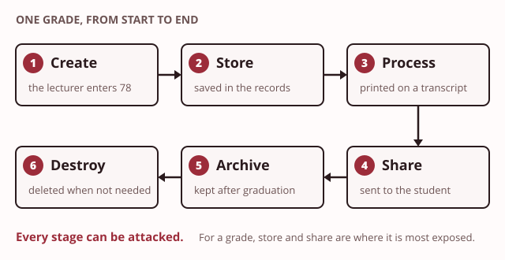
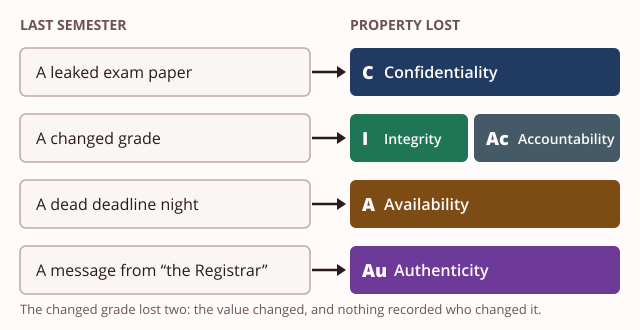
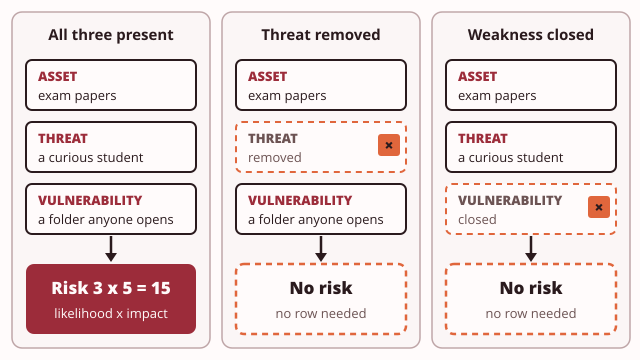

# Day 1: What we protect, and from what

These notes cover the Day 1 morning: what Taxila College must protect, the five security properties, the words for [risk](../../glossary.md#risk), and the controls and law that answer it.

> **Recall.** In Year 1 you learnt that data crosses a network as messages sent between devices.

Today you join the information technology (IT) office of Taxila College as a trainee security analyst. Taxila is a fictional private college with a main campus in Colombo and a branch in Kandy. Last semester, four things went wrong:

| What happened | In one line |
|---|---|
| A leaked paper | A draft exam paper appeared on a student messaging group two days before the exam. |
| A changed grade | A final grade in the student records was higher than the lecturer entered, and nothing showed who changed it. |
| A dead deadline night | On the last evening for fees, the fee payment page stopped responding for three hours. |
| A message from "the Registrar" | Staff received an email that seemed to come from the Registrar, asking them to update their bank details. Two people did. |

Each idea this morning gives you a word for part of what went wrong. By the end you can name each problem exactly, which is the first step to fixing it.

## 1. Data, information and knowledge

Try the demo first: [Data, information and knowledge](artefacts/data-vs-information.html). Type a value, add a label, and watch it gain a meaning.

A raw value carries no meaning on its own. The value `78` could be a grade, a room number or a speed. Add context, such as "final grade for one student", and the value becomes **information**. Put information together and apply it, such as "this student's grades fell in every module this year", and it becomes **knowledge**.

> **You already know this.** A parcel sits in a sorting office. Its label gives an address, so the post office knows where it goes. A worker who sees several parcels with the same address knows they belong to one family.
>
> *Mapping:* the parcel = data; the address on the label = the context that makes it information; knowing which parcels travel together = knowledge.

Data comes in three shapes:

- **Structured** data sits in fixed rows and columns. The Student Information System (SIS) holds structured records: every student has the same fields.
- **Semi-structured** data carries labels but no fixed table. The header lines of an email (From, To, Subject) are labelled, but each message has a different set.
- **Unstructured** data is free text, pictures or sound. The body of an email in a mailbox is unstructured.

Data also moves through a **lifecycle**: it is created, stored, processed, shared, archived and finally destroyed. Every stage can be attacked. Follow one grade. It is created when the lecturer enters it, stored in the SIS and processed into a transcript. It is shared with the student, archived after graduation, and destroyed when the college no longer needs it.

Finally, data is sorted by sensitivity, which is called [classification](../../glossary.md#data-classification). Taxila uses four classes: public, internal, confidential and restricted. The test for every class is the harm a leak would cause. Section 6 holds Taxila's full classification page.

> **Taxila.** Taxila keeps structured grades, unstructured mail and restricted exam papers, each at a different sensitivity.

> **Quick check.** The Student Information System holds every student's national identity card number. Which class does Taxila's table give these numbers?
>
> - [ ] Public
> - [ ] Internal
> - [x] Restricted
> - [ ] Confidential
>
> **Why:** A leak of identity card numbers causes serious harm and may break the law, so they are restricted: the fewest people possible may read them. Confidential is tempting because they are personal data, but restricted is the class for the most serious harm.

## 2. Confidentiality, integrity and availability

Try the demo first: [Read, change, block](artefacts/cia-channel.html). Turn on each problem in turn and see which property is lost.

Three properties describe what "secure" means for data. Each is easiest to understand by what its loss looks like.

| Property | What it means | What its loss looks like at Taxila |
|---|---|---|
| **[Confidentiality](../../glossary.md#confidentiality)** | Only authorised people can read the data. | The exam paper was read by students before the exam. |
| **[Integrity](../../glossary.md#integrity)** | The data has not been changed without permission. | A grade was changed, and the record kept the new value. |
| **[Availability](../../glossary.md#availability)** | The data and the service are there when they are needed. | The fee payment page did not respond on the last evening. |

Notice that one property can be lost while the others hold. On the fee night, nobody read or changed a single record. Only availability was lost, and it still cost the finance office a week of work.

> **You already know this.** Picture a post box with a sealed slot, a tamper strip across its door, and a front that is always open for posting.
>
> *Mapping:* the seal = confidentiality; the tamper strip = integrity; the box always open to post = availability.

> **Taxila.** The leaked exam paper broke confidentiality, the changed grade broke integrity, and the dead fee-payment night broke availability.

> **Quick check.** On the last evening for fees, the fee payment page stopped responding for three hours. No record was read and no record was changed. Which property was lost?
>
> - [x] Availability, because the service was not there when students needed it
> - [ ] Integrity, because students' payments were recorded late
> - [ ] Confidentiality, because payments go through a bank's gateway
>
> **Why:** The page was not there when it was needed, so availability was lost. Integrity is tempting because late fees followed, but no record was changed without permission.

## 3. Authenticity and accountability

Try the demo first: [Beyond the first three](artefacts/beyond-cia.html). Read a message from an impersonated sender, then a change someone denies, and read the log.

Look again at the message from "the Registrar". Nobody read it who should not have, it arrived unchanged, and it arrived on time. Confidentiality, integrity and availability all held, and two people were still deceived. Three properties are not enough.

- **[Authenticity](../../glossary.md#authenticity)** answers one question: does this really come from who it claims to come from? The message failed authenticity: it was not from the Registrar.
- **[Accountability](../../glossary.md#accountability)** answers another: can you prove who did what? The changed grade failed accountability: the record showed the new grade, but not who changed it.
- **[Non-repudiation](../../glossary.md#non-repudiation)** is the strong form of accountability. It means a person cannot later deny an action they took, because the record proves it.

These five are the security properties: confidentiality, integrity, availability, authenticity and accountability. They describe the state you want your data to be in.

> **You already know this.** A letter is signed by its writer, and a named witness notes who signed it and when.
>
> *Mapping:* the signature = authenticity; the witness's note of who signed = accountability; being unable to deny you signed = non-repudiation.

> **Taxila.** The fake message from the Registrar failed authenticity; the grade changed with no record of who changed it failed accountability.

> **Common mistake.** "The five properties are the three processes called triple-A." They are separate lists. The properties describe the state you want. The processes are things a system does, and they come on Day 5. Keep the two lists apart from today.

> **Quick check.** At a provincial land records office, an officer says she never approved a change to a land deed. The system shows the change, but not who approved it. Which property is missing?
>
> - [ ] Authenticity, because the change may not be genuine
> - [x] Accountability, because nobody can prove who approved it
> - [ ] Availability, because the officer cannot see the approval
>
> **Why:** The record cannot prove who did what, so her denial cannot be checked: that is accountability. Authenticity is tempting, but it asks whether something comes from who it claims, and here nothing claims to come from anyone.

## 4. Asset, threat, vulnerability and risk

Try the demo first: [The risk equation](artefacts/risk-equation.html). Slide likelihood and impact, then remove the [threat](../../glossary.md#threat) or close the weakness.

Four words let you describe any problem before you fix it:

- An **[asset](../../glossary.md#asset)** is anything worth protecting: data, a system, a service, the college's good name.
- A **threat** is what could cause harm.
- A **[vulnerability](../../glossary.md#vulnerability)** is the weakness that lets the threat cause the harm.
- **Risk** combines how likely the harm is with how much it would cost.

Taxila scores both parts from 1 (low) to 5 (high), and multiplies them. A risk score is therefore between 1 and 25. Here is the example row in Taxila's risk register template. The asset is the restricted exam papers; the threat is a curious student. The vulnerability is a shared folder that anyone at the college can open. Likelihood 3, impact 5, score 15.

Risk needs both a threat and a vulnerability. Remove the threat, or close the vulnerability, and the risk falls away. That is why every fix in this module either closes a weakness or keeps a threat away from it.

Threats come from different **threat actors**, and they behave differently:

- An **insider** is someone inside the organisation, such as a staff member who misuses access they already have.
- An **organised criminal** works with others for money, for example by tricking staff into changing bank details.
- An **opportunist** uses whatever is left open, without choosing a target first.

> **You already know this.** A shop keeps cash in its till, a back window is left unlocked, and a thief walks past every evening.
>
> *Mapping:* the cash = the asset; the thief = the threat; the unlocked window = the vulnerability; the chance and cost of a break-in = the risk.

> **Taxila.** Restricted exam papers in a shared folder, with a curious student nearby, are an asset, a vulnerability and a threat together.

> **Common mistake.** "A weakness on its own is a risk." With no threat to use it, a vulnerability carries no risk. Write the threat down every time: if you cannot name one, you have not found a risk yet.

> **Quick check.** Which of these is a risk, not only a weakness or a threat?
>
> - [ ] A folder of exam papers that anyone at the college can open
> - [ ] A student who would like to see the exam paper early
> - [x] A curious student could open papers in a folder anyone can open
>
> **Why:** A risk needs both halves: a threat that could use a weakness, against an asset. The first option is only the vulnerability, and the second is only the threat.

## 5. Controls, the law and personal data

Try the demo first: [Control layers](artefacts/control-layers.html). Place each control in its box, then build the layers and see what happens when one fails.

A **[control](../../glossary.md#control)** is anything that lowers a risk. Controls are sorted in two ways at once. By what they do:

- **Preventive** controls stop the harm before it happens.
- **Detective** controls notice the harm when it happens.
- **Corrective** controls repair things after the harm.

By how they work:

- **Technical** controls are built into systems.
- **Administrative** controls are rules, procedures and training.
- **Physical** controls are locks, doors and cameras.

| | Technical | Administrative | Physical |
|---|---|---|---|
| **Preventive** | the SIS lets lecturers change grades only | exam papers go only in the examinations office's folder | a locked server-room door |
| **Detective** | a record of who changed each grade | staff report any odd email to the IT office | a camera at the server-room door |
| **Corrective** | the weekly backup to an external disk | a plan to call the Head of IT and restore service | a fire extinguisher in the server room |

No single control is enough. So organisations use several **independent** layers, so that one failing does not leave the asset open. This is called **defence in depth**. The word that matters is independent: two controls that fail for the same reason are one layer, not two.

> **Quick check.** Taxila puts a camera at the server-room door. What kind of control is it?
>
> - [ ] Preventive and technical
> - [ ] Corrective and administrative
> - [ ] Preventive and physical
> - [x] Detective and physical
>
> **Why:** A camera does not stop anyone entering; it notices who came in, so it is detective. It is a physical thing. Preventive and physical describes the lock on the same door.

> **You already know this.** A building has a locked door, a camera over the door, and a plan to call for help if someone gets in.
>
> *Mapping:* the lock = a preventive control; the camera = a detective control; the call-for-help plan = a corrective control; using all three = defence in depth.

> **Common mistake.** "More tools always means more security." Layers help only when each is an independent control. Two products that both trust the same password fail together when that password leaks.

The law also draws lines in this work.

> **Recall.** Before Day 1 you learnt that every lab uses only your own machine and the provided material, because testing a system without written permission is an offence.

The line the law draws is permission. Testing your own systems, or systems you have written permission to test, is lawful. Anything else is an offence under Sri Lanka's Computer Crime Act, No. 24 of 2007. Under the Act it is an offence to gain access to a computer, or to the information in it, without lawful authority. It is also an offence to make a computer do something that damages or changes it without lawful authority. The penalties include fines and up to five years in prison.

> **Common mistake.** "Scanning a system is fine as long as you do no damage." Without permission it is an offence under the Computer Crime Act, No. 24 of 2007. Access without lawful authority is enough; damage is not needed.

Personal data is any data about a person who can be identified from it, such as a name with a national identity card number. Sri Lanka's Personal Data Protection Act, No. 9 of 2022, places duties on any organisation that holds personal data. The college must know what personal data it holds, use it only for a stated purpose, keep it safe and correct, and keep it no longer than needed. At the time of writing, the Act's Data Protection Authority is set up, and a government order has fixed the date from which the duties on organisations apply. The Authority's own site gives the current position.

> **Taxila.** The Data Protection Officer asks whose personal data the college holds, under the Personal Data Protection Act.

## 6. Taxila's classification page

This afternoon's lab uses this page. Taxila sorts its data into four classes. The test for every class is the harm a leak would cause.

| Class | Meaning at Taxila | Examples |
|---|---|---|
| Public | may be published | course catalogue, news, campus addresses |
| Internal | for staff and students; harmless if leaked, but not for publication | timetables, staff directory, room bookings |
| Confidential | personal or business data whose leak harms a person or the college | student records, grades, fee balances, staff salaries |
| Restricted | data whose leak causes serious harm or breaks the law; the fewest people possible | exam papers before the exam, national identity card numbers, the administrator's sign-in details for the SIS |

The systems Taxila runs, and what each holds:

| System | What it holds or does |
|---|---|
| Student Information System (SIS) | student records, grades, fee balances, national identity card numbers |
| Learning Management System (LMS) | course pages, coursework submissions, feedback |
| Fee payment page | lets students pay fees through a bank's payment gateway; Taxila never stores card numbers |
| Email | staff and student mailboxes at `taxila.example` |
| Exam paper store | a shared folder where lecturers place exam papers before an exam |
| Website | the public course catalogue and news |

## Before the lab

This afternoon you classify every kind of data on Taxila's worksheet, mark where the most sensitive kinds are exposed, and write the first ten rows of Taxila's risk register. Bring these notes, open at section 6. You need no virtual machine today.

## Reading

- Pfleeger, C. P., Pfleeger, S. L. and Coles-Kemp, L., *Security in Computing*, 6th ed., chapter 1, sections 1.1 to 1.5: what security is, threats, harm, vulnerabilities and controls. The 4th edition, by the first two authors, has the same ideas in chapter 1.
- Computer Crime Act, No. 24 of 2007, Sri Lanka, sections 3 to 5.
- Personal Data Protection Act, No. 9 of 2022, Sri Lanka, as amended by Act No. 22 of 2025: the duties of organisations that hold personal data.

Next: Day 2, secrecy with keys. You learn how to keep data confidential even when someone can see it.
