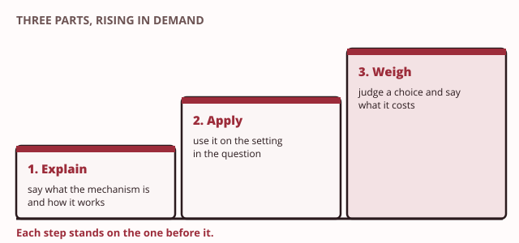

# Day 10: Group exercise, synthesis and exam preparation

These notes cover Day 10. The first section is a short briefing for the morning's group exercise. The rest is the afternoon. It walks back down the nine days, separates two lists that are easy to confuse, and shows how to answer a practice question so that it earns its marks.

## This morning: the group exercise

> **Recall.** The five properties, the risk register and the continuity plan your group has built.

> **Recall.** Accountability means being able to prove who did what.

This morning your group is Taxila College's security team. Your lecturer describes an incident at the college, and every few minutes something new happens. Your group agrees what to do, and your incident lead writes each action in the action log. The full rules are in the [group tabletop exercise brief](../../coursework/tabletop-brief.md).

Bring these, printed or on one laptop:

- your group's risk register, with at least ten risks (item 2 on Taxila's security register);
- your controls map: each control you rely on, the risks it answers, and whether it prevents, detects or corrects;
- your continuity plan, with a recovery time and a recovery point for each service (item 19).

You hand in the register and the map at the start of the round. You keep the continuity plan: you will need it.

Write every line of the action log in the same shape, so that someone who was not there can follow it:

| Time | What happened | What we did | Why | Who |
|---|---|---|---|---|
| 8.40 | Grade pages will not open | Told the Registrar; asked what the monitoring shows | Find out how far it reaches before we touch anything | Incident lead |

The "Why" column is the one that earns marks. An action with no reason looks like a guess. A reason shows that your group chose it, which is the same idea as accountability: being able to show who did what, and why.

> **Quick check.** Which action-log line would someone who was not in the room understand best?
>
> - [ ] "Fixed the firewall."
> - [ ] "9.10: Technical lead dealt with the server, it is fine now."
> - [x] "9.10: Cut the server room off from the staff network at the firewall, so the problem cannot spread to staff machines. Technical lead."
>
> **Why:** The third line says when, what, why and who. The first has no time, no reason and no owner. The second names a person but not the action or the reason, so nobody could check it later.

At the end of the round, each member answers one short question about a role that is not their own. Afterwards your group writes the after-action report and updates the continuity plan, as the brief explains.

## This afternoon

In the afternoon you stop meeting new ideas. You walk back down the nine days, from what we protect to how we keep running, and check that each idea still rests on the ones beneath it. Then you separate two lists that look alike. Last, you practise answering questions set somewhere other than Taxila.

## 1. The spine, end to end

Each teaching day added one idea, and each idea rested on earlier ones. That order is the module's spine. If you can climb it from the bottom, you can rebuild almost any answer you need.

> **Recall.** Data and the five properties, from Day 1.

**Day 1: what we protect, and why.** Data has value, so it is an asset. The five properties say what must hold for it: [confidentiality](../../glossary.md#confidentiality), [integrity](../../glossary.md#integrity), availability, authenticity and [accountability](../../glossary.md#accountability). A [risk](../../glossary.md#risk) combines how likely a harm is and how much it would cost. Items 1 and 2 on the register, the data inventory and the risk register, answer the Data Protection Officer's first question: "Whose data is this?"

> **Recall.** Keys and the hybrid pattern, from Day 2.

**Day 2: secrecy with keys.** Encryption protects confidentiality. A symmetric key is fast but hard to share; an asymmetric pair solves the sharing. [Hybrid encryption](../../glossary.md#hybrid-encryption) uses asymmetric methods to set up a fast symmetric key. Items 3 and 4, the encrypted exam paper store and the key exchange with Kandy, answer the leaked paper.

> **Recall.** Hashing and salting, from Day 3.

**Day 3: fingerprints.** A hash function turns any input into a short digest, and any change gives a different digest. That protects integrity. A [salt](../../glossary.md#salt) makes each stored password's digest unique. Items 5 and 6, the password store and the results file check, answer the changed grade and password reuse. Day 3 rests on Day 1's integrity, not on Day 2's keys: a hash has no key.

> **Recall.** Signatures, certificates and transport security, from Day 4.

**Day 4: proving who.** A [digital signature](../../glossary.md#digital-signature) is a digest locked with a private key, so it rests on Day 2's key pairs and Day 3's digests together. A certificate binds a name to a public key, and secure web traffic uses both to prove the portal is genuine. Items 7 and 8, signed transcripts and the portal certificate, answer the Registrar's reputation and the look-alike page.

> **Recall.** The three processes set against the five properties, from Day 5.

**Day 5: who may do what.** Three processes run when someone signs in: authentication, authorisation and accounting. [Least privilege](../../glossary.md#least-privilege) gives each account only what its job needs. Items 9 and 10 are accounts and roles, and the hardened server. They answer the Registrar: "Can we prove who changed it?" Day 5 rests on Day 1's accountability and on Day 4's proof of which person acted.

> **Recall.** Web input and sessions, email authentication and database least privilege, network zones, and attacks, risk and continuity, from Days 6 to 9.

**Days 6 to 9: each part of the college.** Day 6 kept typed input from being read as a command, with a [parameterised query](../../glossary.md#parameterised-query). It also protected the session token (items 11 and 12). Day 7 let receiving servers check that email really came from Taxila, and gave each account in the Student Information System (SIS) database only what its job needs. Those are items 13 and 14. Day 8 divided the network into zones, with firewalls between them, monitoring, and a private link to Kandy (items 15, 16 and 17). Day 9 described attacks, chose a treatment for each risk, and planned how to keep running when something fails anyway (items 18 and 19). Each of these four days rests on Day 5's roles, and on one earlier floor as the drawing shows.

> **Key idea.** Every control on the register answers a problem from Taxila's story. When you name a control, say which problem it answers and which earlier idea it rests on.

> **You already know this.** You built a building one floor at a time, and each floor stood on the one below. Now you climb back down it, naming each floor as you pass, until you stand on the ground it all rests on.
>
> *Mapping:* each floor you pass = one day's idea; the ground you reach = the five properties that everything rested on.

> **Taxila.** The nineteen register items, read in order, retell the whole placement. They run from knowing what data the college holds (item 1) to bringing the college back after a failure (item 19).

> **Quick check.** The Registrar wants employers to trust a Taxila transcript without phoning the college. A signed transcript does this. Which two earlier ideas does the signature rest on?
>
> - [ ] Salting and firewalls
> - [x] Key pairs and digests
> - [ ] Least privilege and backups
> - [ ] Encoding and zones
>
> **Why:** A signature is a digest of the transcript, locked with the Registrar's private key. So it needs Day 3's digests and Day 2's key pairs. Salting is for stored passwords, not for proving who issued a document.

## 2. The two lists, one more time

Two lists in this module look alike, and mixing them up costs marks.

- The **five properties** say what must hold: confidentiality, integrity, availability, authenticity and accountability.
- The **three processes** say how a system checks and records: [authentication](../../glossary.md#authentication), authorisation and [accounting](../../glossary.md#accounting).

| Properties: what must hold | Processes: how a system checks and records |
|---|---|
| Confidentiality: only the right people can read it | Authentication: is this really who they claim to be? |
| Integrity: nobody has changed it without permission | Authorisation: what may this account do? |
| Availability: it works when it is needed | Accounting: write down what each account did |
| Authenticity: it really comes from who it says | |
| Accountability: you can prove who did what | |

A process term is not a property term, even when the words look alike:

- **Authentication is not authenticity.** Authentication is the check at sign-in. Authenticity is the property that something is genuine. Authentication helps to protect authenticity.
- **Accounting is not accountability.** Accounting is the act of recording each action. Accountability is the property that you can prove who did what. The records from accounting give you accountability.

> **You already know this.** Two keys on your key ring look almost the same. One opens the front door and the other opens the gate. If you use the wrong one, nothing opens, however hard you turn it.
>
> *Mapping:* the five-property key = what must hold; the three-process key = how a system checks and records; they open different locks.

> **Taxila.** The changed grade touched both lists: the integrity property was lost, because a grade changed without permission, and the accounting process was missing, because nothing recorded who changed it.

> **Common mistake.** "The properties and the processes are one list." They are two lists, and a question expects the right term. If a question asks which property was lost, "authentication" is not an answer; "authenticity" may be.

> **Quick check.** A tea estate's payroll office lets each clerk sign in with a password and a code from a phone. Which list does "signing in with a password and a code" belong to, and which item on that list?
>
> - [ ] The properties: authenticity
> - [ ] The properties: accountability
> - [x] The processes: authentication
>
> **Why:** Checking a password and a code is something the system does, so it is a process: authentication. It helps to protect the authenticity of each clerk's actions, but authenticity is the property, not the check. Choosing "authenticity" is the most common slip.

## 3. Answering the practice questions

Each of the nine practice questions starts from a short scenario that is not Taxila: a clinic, an online bookshop, a tea estate's payroll office, a ride-hailing app. So recall alone will not answer it. You must carry an idea from Taxila to a new place.

Each question has three parts, and they rise in demand:

1. **Explain** a mechanism: what it is, and how it works.
2. **Apply** it to the scenario: map it, design it, or find the flaw.
3. **Weigh** a choice: compare options, judge a trade-off, or say what could still go wrong.

**Name the mechanism precisely, and say why it works, not only what it is.** Here is part of an answer to the online bookshop question (practice question 3). The bookshop stored unsalted SHA-256 (Secure Hash Algorithm, 256 bits) digests of its customers' passwords.

| An answer that only names | An answer that explains |
|---|---|
| "They should use salting." | "Give each customer a unique random salt, stored with their row. The system adds the salt to the password before hashing. Two customers with the same password then get different digests, and a lookup table built in advance no longer matches any of them." |

The first line names the right mechanism and earns little. The second says what the salt is, where it lives, what the system does with it, and why that defeats the attack. That is the difference between knowing a word and understanding an idea.

> **You already know this.** A driving test takes you onto roads you have never practised on. You still pass, because you learnt how to drive, not one route.
>
> *Mapping:* unfamiliar roads = an unfamiliar scenario; the skills still transfer = the ideas transfer beyond Taxila.

> **Taxila.** The nine practice questions used other Sri Lankan settings for exactly this reason: to train you to carry each idea away from Taxila.

> **Common mistake.** "Naming a mechanism is the same as explaining it." Showing why a mechanism works earns the marks, not only its name.

> **Quick check.** A school examinations board keeps one backup of its results database, made every night on a disk next to the server. Which sentence answers the "weigh" part of a question about this?
>
> - [ ] "The board should follow the three-two-one backup rule."
> - [x] "An hourly copy to a second site costs more, but it is worth it on results day, when a nightly copy could lose almost a day of entries."
> - [ ] "A backup is a copy of data kept so that it can be restored."
>
> **Why:** Weighing means judging a choice and saying what it costs and what it gains. The first sentence names a rule but judges nothing. The third explains a word, which belongs in the first part of an answer.

## 4. Timed practice

This afternoon you practise against the clock, then mark each other's work.

1. **Three rounds of 15 minutes.** In each round, answer one practice question in writing, without your notes. Take one question from each third of the module:
   - question 1 or 5: properties, risk and the three processes;
   - question 2, 3 or 4: cryptography;
   - question 6, 7, 8 or 9: web, email, networks, attacks and continuity.
2. **Mark each other's answers for understanding, not wording.** Swap with a partner and read their answer against the question's answer guidance. For each part, ask four things: Does it name the right mechanism? Does it say why the mechanism works? Does it use the scenario, not Taxila? Does the last part weigh a choice?
3. **Collect what you could name but not yet explain.** Keep a short list of every mechanism you named but could not explain. Revise those first, from the day that taught them.

The [practice questions](../../practice/README.md) are all in one place, each with its answer guidance.

## Before the examination

- Read your notes for all nine days in order, from Day 1. Stop at each Recall box and say the idea aloud before you read on.
- Work through the module-wide words ladder and quiz on this day's page. They draw on all nine days.
- Revise the mechanisms on your "could name but not explain" list until you can explain each one in three sentences.
- After the morning, your group submits its after-action report and updated continuity plan, as the brief explains.
