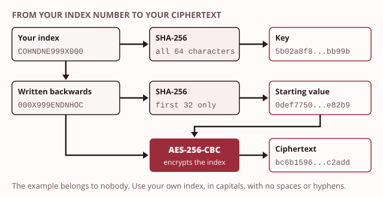

# Lab 2: Ciphers by hand, then with the Advanced Encryption Standard

**Day 2, afternoon session. Duration 3 hours. Adds item 3 to Taxila's security register.**

This lab sheet takes you from breaking a shift cipher by hand to encrypting your own message with the Advanced Encryption Standard (AES). You then see a wrong key fail, and encrypt to a public key.

| | |
|---|---|
| Learning outcomes | LO2 |
| You need | this morning's ideas: [plaintext](../../glossary.md#plaintext), [key](../../glossary.md#key) and [ciphertext](../../glossary.md#ciphertext); [symmetric encryption](../../glossary.md#symmetric-encryption) with one shared key; [asymmetric encryption](../../glossary.md#asymmetric-encryption) with a public and a private key |
| Tiers | Floor tier: every step, in the browser. Full tier: segments 2 to 5 can also run in your Kali virtual machine, with the same results |
| Evidence pack | Pack 2, due before the next teaching day |

## Before you start

1. Open this page and the day's notes side by side.
2. Write down your personal value: your index number without spaces or hyphens, with its letters in capitals exactly as issued (the example in this sheet, `COHNDNE999X000`, belongs to nobody).
3. Full tier: start your Kali virtual machine and take a snapshot named `day-2-start`, so Reset can bring it back.
4. Floor tier: open the demos this lab uses: `caesar-wheel` and `frequency-bars`. Open CyberChef too, from its official site or your offline copy.
5. Download the two provided files: [`shift-cipher.txt`](files/shift-cipher.txt) and [`module-public-key.txt`](files/module-public-key.txt). Save them in your module folder.

### The idea behind today's lab

> **Recall.** A key makes encryption reversible for the right person.

> **Recall.** Symmetric encryption shares one key; asymmetric encryption uses a public key and a private key.

> **Common mistake.** "The wrong key gives a partial answer." The wrong key fails outright or returns nonsense. Your message does not come back half right. Segment 3 shows you this with your own message.

> **Common mistake.** "Encrypting to a public key means you can read it back." Only the matching private key can open it. In segment 4 you lock a message that you cannot open yourself.

> **Quick check.** This lab makes your AES key from your index number, by a recipe printed on this page. Why would that be a poor key for real exam papers?
>
> - [ ] AES needs a key made from a password instead
> - [ ] A key must be kept as long as the message
> - [x] Anyone who knows your index and the recipe can make the same key
>
> **Why:** Kerckhoffs's principle says the method may be public, so the key alone must be secret. Here the recipe is public and an index number is not secret, so the key is not secret either. It is fine today only because the message is not a secret.

> **Quick check.** In segment 4, you encrypt your AES key to the module's public key. Who can open what you made?
>
> - [x] Only the holder of the module's private key
> - [ ] You, because you made it
> - [ ] Anyone who has the public key
>
> **Why:** What a public key locks, only the matching private key opens. Making it yourself is tempting as a reason, but you hold only the public key, and a public key cannot open what it locked.

## Objective

You will break a shift cipher by hand, then encrypt your own index number with AES so that only the key returns it. You will also lock a message with a public key. This is how Taxila's exam paper store keeps papers unreadable, even if the folder leaks.

## Timed segments

| Segment | Minutes | Tier |
|---|---|---|
| Break a shift cipher by hand | 25 | both |
| Encrypt your personal message with the Advanced Encryption Standard | 40 | both |
| The wrong key | 25 | both |
| Encrypt to a public key and meet the hybrid idea | 35 | both |
| Prove it, break it, reset and write up | 25 | both |

## Steps

Each step states what to do and what you should see. If you do not see it, stop and work out why before moving on.

*Segment 1: Break a shift cipher by hand*

1. **Count the letters.** Open `frequency-bars` and choose the lab's message, or paste the text of `shift-cipher.txt` into it. Find the tallest bar. In English the commonest letter is usually e. *Expected:* one ciphertext letter stands far above the rest. If it stands for e, you can work out the shift: count how many places it sits after e in the alphabet.

2. **Check the shift with the wheel.** Open `caesar-wheel`, choose the lab's message, and turn the wheel back by the shift you found. Then press the button that tries every key, to confirm. *Expected:* a readable message from Taxila's examinations office. Write down the shift and the first sentence of the plaintext.

> **Floor path.** Both tiers do segment 1 in the browser, with the two demos. You can also work on paper: write the alphabet twice, one row under the other, and slide the lower row by the shift.

*Segment 2: Encrypt your personal message with the Advanced Encryption Standard*

Your evidence must be your own, and your lecturer must be able to check it. So your key and your starting value are made from your index number by a fixed recipe. The recipe uses SHA-256 (Secure Hash Algorithm, 256 bits). Day 3 explains what SHA-256 is. Today it is only a recipe that turns your index number into a value of the right length.

> **Note.** A real key is chosen at random and kept secret. This lab's key is made from your index number, by a recipe printed on this page. Anyone who knows your index could make it, so it would be a poor real key. It is fine here, because today's message is not a secret: the point is to see how the key works.



3. **Try the recipe on the example first.** Work through steps 4 to 6 with the example `COHNDNE999X000`, and check that you get these values. Then repeat them with your own index number. *Expected:* for the example, the key is `5b02a8f821835e23aa2d08921e40ddb0e0e21220f3e7d4e0a979bc9e962bb99b`, the starting value is `0def77507f34a59d5dbf643c1c6e82b9`, and the ciphertext is `bc6b159611b059c4db6b8eb5b1ac2add`.

4. **Make your key.** Your plaintext is your index number, with nothing before or after it. Take the SHA-256 of your plaintext. *Expected:* 64 hexadecimal characters. That is 32 bytes, which is 256 bits: an AES-256 key.

5. **Make your starting value.** Write your index number backwards, by hand. Check it with CyberChef's `Reverse` operation. Take the SHA-256 of the reversed index, and keep only its first 32 hexadecimal characters. *Expected:* 32 hexadecimal characters, which is 16 bytes. Cipher block chaining (CBC) mixes this starting value into the first block.

6. **Encrypt your plaintext.** Encrypt your plaintext with AES-256 in CBC mode, using your key and your starting value. *Expected:* 32 hexadecimal characters for a 14-character index number. You cannot read them. They are the same on both tiers, and the same as your lecturer's recompute tool gives.

> **Floor path.** In CyberChef, type your index number in the input box, with no space or new line after it. For step 4, add `SHA2` and set its `Size` to `256`; the default is 512, which is wrong here. For step 5, put your reversed index in the input box, add `SHA2` with `Size` `256`, then `Take bytes` with `Start` `0` and `Length` `32`. For step 6, put your index number back in the input box and use one operation only: `AES Encrypt`. Put your key in `Key` and your starting value in `IV` (initialisation vector), both set to `HEX`. Set `Mode` to `CBC`, `Input` to `Raw` and `Output` to `Hex`.

Full tier, in a terminal on your Kali virtual machine. Replace the example with your own index number, and the reversed example with your own reversed index:

```bash
mkdir -p ~/lab2 && cd ~/lab2
printf '%s' COHNDNE999X000 > plain.txt
printf '%s' COHNDNE999X000 | sha256sum | cut -c1-64
printf '%s' 000X999ENDNHOC | sha256sum | cut -c1-32
openssl enc -aes-256-cbc -nosalt -K <your key> -iv <your starting value> -in plain.txt -out cipher.bin
xxd -p cipher.bin
```

The third command prints your key and the fourth your starting value. Copy each one into the `openssl` command in place of `<your key>` and `<your starting value>`.

Use `printf`, not `echo`, to write the plaintext. `echo` adds an invisible line ending, which changes the plaintext and so the ciphertext. If your virtual machine says `xxd: command not found`, run `sudo apt install xxd` and try again.

*Segment 3: The wrong key*

7. **Decrypt with your key.** Decrypt your ciphertext with your key and your starting value. *Expected:* exactly your index number, with nothing missing and nothing added.

8. **Decrypt with a changed key.** Copy your key and change its last character to a different hexadecimal digit, for example `b` to `c`. Decrypt again with the changed key. *Expected:* it fails. The full tier prints the words "bad decrypt" and an error line. CyberChef usually shows the error `Unable to decrypt input with these parameters.`, and sometimes an empty or garbled result. You never see your index number, or part of it.

> **Floor path.** In CyberChef, put your ciphertext in the input box and use `AES Decrypt`, with `Key` and `IV` set to `HEX`, `Mode` `CBC`, `Input` `Hex` and `Output` `Raw`.

Full tier:

```bash
openssl enc -d -aes-256-cbc -nosalt -K <your key> -iv <your starting value> -in cipher.bin
openssl enc -d -aes-256-cbc -nosalt -K <your changed key> -iv <your starting value> -in cipher.bin
```

The first command prints your index number. Your prompt appears on the same line, because your plaintext has no line ending.

*Segment 4: Encrypt to a public key and meet the hybrid idea*

9. **Encrypt your plaintext to the module's public key.** Use the provided `module-public-key.txt` with the Rivest, Shamir and Adleman method (RSA). *Expected:* 256 bytes of ciphertext, which is 512 hexadecimal characters. Run it again and the result is different. That is normal: the method adds random padding each time.

10. **Try to open it yourself.** You hold only the public key. *Expected:* you cannot open it. CyberChef's `RSA Decrypt` asks for a private key, which you do not have. On the full tier, `openssl` refuses, saying a private key is needed.

11. **Carry your AES key the same way.** Encrypt your AES key, the 64 characters from step 4, to the public key. *Expected:* another 512 hexadecimal characters. This is the hybrid pattern done by hand. The slow public-key method carries only the short AES key, and the fast AES key carries the message. Your lecturer, who holds the private key, opens two volunteers' files in front of the class.

> **Floor path.** In CyberChef, put your index number in the input box and use `RSA Encrypt`. Paste the whole text of `module-public-key.txt` into `RSA Public Key (PEM)`, including its first and last lines. Keep `Encryption Scheme` `RSA-OAEP` and `Message Digest Algorithm` `SHA-1`. Then add `To Hex` with `Delimiter` `None`. For step 11, put your key in the input box instead.

Full tier. Save `module-public-key.txt` in `~/lab2` first: download it in the virtual machine's browser, or paste its text into `nano module-public-key.txt`.

```bash
openssl pkeyutl -encrypt -pubin -inkey module-public-key.txt -pkeyopt rsa_padding_mode:oaep -in plain.txt -out to-module.bin
wc -c to-module.bin
openssl pkeyutl -decrypt -pubin -inkey module-public-key.txt -in to-module.bin
printf '%s' <your key> > key.txt
openssl pkeyutl -encrypt -pubin -inkey module-public-key.txt -pkeyopt rsa_padding_mode:oaep -in key.txt -out key-to-module.bin
```

The second command shows `256 to-module.bin`. The third fails, because a public key cannot open what it locked.

*Segment 5: Prove it, break it, reset and write up*

12. **Collect your evidence.** Fill in the evidence pack table with your values from steps 4 to 8, and the shift and plaintext from segment 1. *Expected:* every value comes from your own index number.

13. **Draw and explain.** Draw the two-key sketch and write your explanation, as listed under Evidence required. *Expected:* a labelled sketch and at most 120 words.

## Prove it

Decrypting your ciphertext with your key returns exactly your index number, and the changed key does not. Your ciphertext equals the value your lecturer's recompute tool gives, because your key and your starting value come from your index number. Copy your plaintext, key, starting value, ciphertext, correct decryption and changed-key result into your evidence pack.

## Break it

**Fault:** one character of the ciphertext changed.

1. Copy your ciphertext and change its last character to a different hexadecimal digit. Decrypt it with your correct key and starting value. **Symptom:** decryption fails, just as it did with the wrong key: "bad decrypt" on the full tier, and in CyberChef usually the error, sometimes an empty or garbled result.
2. **Evidence:** the key and the starting value are unchanged, so the cause must be the ciphertext. AES works on blocks of 16 bytes. One changed character scrambles the whole block when it is decrypted. The end of every message carries a few filler bytes of a fixed pattern, called padding, and the decrypter checks them. Scrambled filler fails the check, so it reports an error.
3. **Fix:** decrypt your original ciphertext again and see your index number return. Write down the symptom and why it happens.

Full tier, to make the changed file:

```bash
printf '%s' <your changed ciphertext> | xxd -r -p > broken.bin
openssl enc -d -aes-256-cbc -nosalt -K <your key> -iv <your starting value> -in broken.bin
```

## Reset

1. Copy your evidence into your evidence pack first.
2. Floor tier: clear CyberChef's recipe and input. Your module folder keeps the two provided files.
3. Full tier: delete the lab folder with `rm -r ~/lab2`, then restore the `day-2-start` snapshot.

## Rules of engagement

No tool in this lab can affect anyone else's system. You encrypt only your own index number and the provided message, on your own laptop or your own virtual machine.

## Evidence required

Submit evidence pack 2 before the next teaching day, using the [evidence pack template](../../templates/evidence-pack.md).

1. **Personal values.** In the template's table, with the step each comes from:
   - the broken shift cipher: the shift you found and the first sentence of its plaintext (segment 1);
   - your plaintext, your key and your starting value (steps 4 and 5);
   - the ciphertext of your plaintext and its correct decryption (steps 6 and 7);
   - your changed key and the result of decrypting with it (step 8).
2. **Concept sketch.** Draw by hand, on paper, the two-key pattern: a sender, a receiver, and the message travelling between them. Show which key the sender uses and which key the receiver uses. Label the public key and the private key, and say whose each one is. Photograph it.
3. **Explanation.** In no more than 120 words: why can the method be public as long as the key is secret?

## Taxila connection

This lab answers the requirement that exam papers are unreadable to anyone without the key, even if the folder leaks. It adds item 3, the encrypted exam paper store, to Taxila's security register. Item 4, the key exchange with the Kandy campus, was this morning's idea. Segment 4 is that idea done by hand: Kandy locks with Colombo's public key, and only Colombo can open it. The Registrar will ask what happens if the folder leaks again: the paper is now ciphertext, and only the key returns it. The Head of IT (information technology) will ask where the key is kept, because the whole protection now rests on that one secret.
