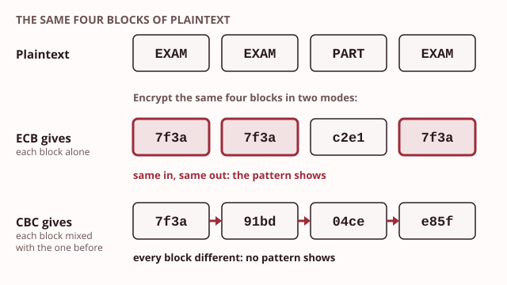
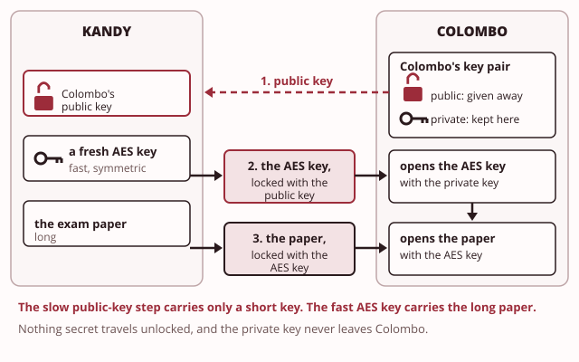

# Day 2: Secrecy with keys

These notes cover the Day 2 morning: how a key keeps data unreadable, and why hand ciphers fail. They also show how encrypting differs from encoding and hiding, and the two families of modern encryption.

> **Recall.** Confidentiality means only authorised people can read the data; that is the property this day serves.

Last semester a draft exam paper leaked from Taxila's exam paper store. The Registrar now has a rule: every paper in the store must be unreadable to anyone without the key, even if the folder leaks again. Then the college's Head of IT (information technology) adds a problem. The Kandy campus prints its own copies of each paper. So the key must reach Kandy, and nobody else may read it on the way.

This morning gives you the ideas behind both parts of the answer. Item 3 on Taxila's security register is the encrypted exam paper store, which you build this afternoon. Item 4 is the key exchange with the Kandy campus, which you meet as an idea today.

## 1. Plaintext, key and ciphertext

Try the demo first: [The Caesar wheel](artefacts/caesar-wheel.html). Turn the wheel to encrypt a message, then press the button that tries every key, and watch how fast the message falls.

Four words describe every kind of encryption:

- **[Plaintext](../../glossary.md#plaintext)** is the readable message.
- **[Ciphertext](../../glossary.md#ciphertext)** is its scrambled form, which you cannot read.
- The **[key](../../glossary.md#key)** is the secret value that turns plaintext into ciphertext, and back again.
- The **algorithm** is the method that uses the key. Another word for it is a **[cipher](../../glossary.md#cipher)**.

Turning plaintext into ciphertext is **encryption**. Turning ciphertext back into plaintext is **decryption**, and it needs the key.

The oldest example is the Caesar shift. Its method is: move every letter a fixed number of places along the alphabet. The key is how many places. With the key 3, `TAXILA` becomes `WDALOD`. To decrypt, you move each letter 3 places back.

Here is the surprising part. The method does not need to be secret. The method may be public, as long as the key stays secret. This is **[Kerckhoffs's principle](../../glossary.md#kerckhoffss-principle)**, named after the scholar who first wrote it down. Every modern cipher follows it, for three reasons:

- A public method can be checked by many experts, so its weaknesses are found and fixed.
- A secret method cannot be changed once it leaks, and then everything it ever protected is open.
- A leaked key can be replaced in minutes, and the method can go on being used.

So the strength of encryption must sit in the key. The Caesar shift fails that test. It has only twenty-five keys, because a shift of 26 brings every letter back to itself. A computer tries all twenty-five in an instant.

> **You already know this.** A combination lock comes in a box. The design of its mechanism is printed on the box, for anyone to read. The lock is still safe, because only you know the combination.
>
> *Mapping:* the lock's mechanism = the algorithm, which is public; the combination = the key, which stays secret.

> **Taxila.** The exam paper store must stay unreadable even if everyone knows it uses a standard algorithm.

> **Common mistake.** "Keeping the method secret is what makes it strong." Security rests in the key; the method can be public. A secret method gives a false sense of safety, and it cannot be replaced once someone learns it.

> **Quick check.** Taxila's exam paper store uses the Advanced Encryption Standard, which is published for anyone to read. What must stay secret for the papers to be safe?
>
> - [ ] The name of the cipher the store uses
> - [x] The key that encrypts the papers
> - [ ] The steps the cipher follows inside
>
> **Why:** By Kerckhoffs's principle, the method may be public and the key alone must stay secret. Hiding the cipher's name or steps is tempting, but a method that leaks cannot be changed, while a key can be.

## 2. Why hand ciphers fail

Try the demo first: [Counting letters](artefacts/frequency-bars.html). Choose a ciphertext, or paste one in, and watch the bars line up with the commonest letters in English.

Before computers, people encrypted by hand. These **classical hand ciphers** fail in two ways.

The first is a small **key space**. The key space is the set of all possible keys. Trying every key, one after another, is called **brute force**. It works whenever the key space is small:

- The **Caesar shift** has twenty-five keys.
- **ROT13 (rotate, or shift, by thirteen)** is one Caesar shift with the key 13. Applying it twice gives back the message, so it hides nothing from anyone who knows it.
- The **Vigenere cipher** uses a keyword. Each letter of the keyword gives a different shift, used in turn. This is harder to break by hand, but the keyword repeats, and the repeats can be counted.

The second way is **[frequency analysis](../../glossary.md#frequency-analysis)**. You count how often each symbol appears in the ciphertext. Languages are not random: in English, the commonest letter is usually e, then t, a and o. A shift cipher moves every e to the same new letter. So the tallest bar in your count is probably e in disguise, and the distance from e gives you the key.

A longer message is easier to break, not harder. It has more letters to count, so the bars settle into the shape of the language. A short message may mislead you, because a few words can by chance repeat an unusual letter.

> **You already know this.** You keep a tally of how often each symbol appears in the message: one stroke for each time you see it. The tallest column of strokes stands out at once.
>
> *Mapping:* the tallest bar in the tally = the commonest ciphertext symbol, which is probably the letter e.

> **Taxila.** A home-made cipher for passing answers would not survive one evening of counting.

> **Quick check.** Two lecturers invent a letter-swap code, where every letter has its own partner, to pass answers in a long note. What would read the note fastest?
>
> - [x] Counting the letters and matching the tallest bar to e
> - [ ] Trying all twenty-five shifts of the alphabet
> - [ ] Asking for the method, since it is kept secret
>
> **Why:** A letter-swap code keeps every letter's count, so frequency analysis names the letters, and a long note gives plenty to count. Trying twenty-five shifts is tempting, but it only works for a shift cipher, where every letter moves by the same amount.

## 3. Encoding, hiding and encrypting

Try the demo first: [Encode, encrypt, hide](artefacts/encode-vs-encrypt-vs-hide.html). Run the same text through all three, then try to get it back without a key.

Three different things can make a message look unreadable. Only one of them protects it.

| | What it does | Needs a key? | Who can get the message back? |
|---|---|---|---|
| **[Encoding](../../glossary.md#encoding)** | changes the form of data so it travels safely, such as Base64 | no | anyone who knows the encoding |
| **[Steganography](../../glossary.md#steganography)** | hides that a message exists at all, for example inside a picture | no | anyone who knows where to look |
| **Encryption** | scrambles the message with a key | yes | only someone with the key |

**Encoding** is not secrecy. Base64 turns any data into letters, digits and two symbols, so it can travel inside text such as an email. The word `Taxila` in Base64 is `VGF4aWxh`. It looks scrambled, but every tool that knows Base64 turns it straight back, with no key.

**Steganography** hides the message in something ordinary. A picture can carry a message in tiny changes to its colours that no eye can see. The hiding works only while nobody looks. Once someone knows where the message is, they can read it.

**Encryption** is the only one of the three that needs a key. Without the key, the ciphertext stays unreadable even when everyone knows the method. The three can be combined: you can encrypt a message and then hide it. Then even if the hiding is found, the content is still protected.

> **You already know this.** A note can be written in shorthand, hidden inside a book, or locked in a safe.
>
> *Mapping:* shorthand = encoding, which anyone fluent reads; the hidden note = steganography; the safe = encryption, where you need the key.

> **Taxila.** A value written in Base64 in a configuration file protects nothing.

> **Common mistake.** "Base64 is a kind of encryption." Base64 has no key and anyone can reverse it. If a file says a password is "encrypted", but it is only letters and digits, perhaps ending in an equals sign, check whether it is Base64.

> **Quick check.** The Head of IT finds the line `password: cGFzc3dvcmQ=` in a configuration file labelled "encrypted". What is it?
>
> - [ ] Ciphertext, which needs the key to read
> - [ ] A hidden message, which needs a picture to carry it
> - [x] Base64 encoding, which anyone can reverse
>
> **Why:** Letters, digits and a closing equals sign are the mark of Base64, and it reverses with no key: this one says `password`. Calling it encrypted is tempting because it looks scrambled, but only encryption needs a key.

## 4. Symmetric encryption and the key problem

Try the demo first: [One key, both ways](artefacts/symmetric-key.html). Encrypt a message, decrypt it with the right key, then try a wrong key, and then two hundred wrong keys.

> **Recall.** The key is the secret value that turns plaintext into ciphertext, and back again.

**[Symmetric encryption](../../glossary.md#symmetric-encryption)** uses one shared key for both directions. The same key encrypts and decrypts. Symmetric ciphers are fast, so they are used for large amounts of data: files, disks and network traffic.

The modern choice is the **Advanced Encryption Standard (AES)**. Its keys are 128, 192 or 256 bits long. The older **Data Encryption Standard (DES)** used a key of only 56 bits. Computers can now try every DES key, so DES is kept only as history.

Key length matters because each extra bit doubles the number of possible keys. A 128-bit key does not have a few more keys than a 56-bit key: it has 72 more doublings. Trying every AES key is far beyond any computer, now or for many years to come.

AES encrypts data in blocks of 16 bytes. How the blocks are joined is called the **mode**:

- **Electronic code book (ECB)** is the simplest mode. It encrypts each block on its own, so two identical plaintext blocks give two identical ciphertext blocks. The pattern of the message leaks through.
- **Cipher block chaining (CBC)** mixes each block with the ciphertext of the block before it. The first block is mixed with a **starting value**, which tools call the initialisation vector (IV). Identical plaintext blocks now come out different, and the pattern is hidden.

Symmetric encryption has one hard part. Both sides need the same key, and it must stay secret. If Colombo encrypts a paper with a key, Kandy needs that exact key to open it. How does the key get to Kandy safely? Post it, email it or phone it, and someone could intercept it on the way. This is the **[key distribution problem](../../glossary.md#key-distribution-problem)**.

> **You already know this.** A locksmith cuts one key twice, so that two people can open the same door. You keep one copy and post the other.
>
> *Mapping:* the single cut key = the symmetric key; posting a copy without it being intercepted = the key distribution problem.

> **Taxila.** Colombo and Kandy both need the paper's key; how is it shared without interception? This is item 4 on the security register.

> **Quick check.** A courier company encrypts its delivery lists with one AES key, shared by its head office and twenty branches. Which part is the hard problem?
>
> - [ ] AES is too slow for long delivery lists
> - [ ] A longer key would make the lists unreadable to the branches
> - [ ] The method must be kept secret from the branches
> - [x] Getting the one key to every branch without anyone intercepting it
>
> **Why:** Symmetric encryption is fast and strong, but every branch needs the same secret key: that is the key distribution problem. Speed is tempting, but speed is symmetric encryption's strength, not its weakness.

## 5. Asymmetric keys and the hybrid pattern

Try the demo first: [The public padlock](artefacts/public-private-pair.html). Close the padlock with the public key, try to open it with the public key, open it with the private key, then try the hybrid pass.

> **Recall.** The key distribution problem is getting one shared key to the other side without anyone intercepting it.

**[Asymmetric encryption](../../glossary.md#asymmetric-encryption)** uses two keys, made together as a pair. The **public key** can be given to anyone. The **private key** is kept by its owner and never shared. You encrypt to someone's public key, and only their private key opens it.

This removes the key distribution problem for secrecy. Colombo makes a key pair and publishes the public key. Kandy uses it to lock a message. Only Colombo, who holds the private key, can open it. Nothing secret ever travels.

The best-known asymmetric method is the **Rivest, Shamir and Adleman method (RSA)**, named after the three people who published it. It rests on a fact about numbers: multiplying two prime numbers is easy, but finding them again from the answer is very hard. A toy example with tiny numbers shows the idea:

| | Toy value |
|---|---|
| Two secret primes | 3 and 11 |
| Their product, which is public | 33 |
| Public key | 3 and 33 |
| Private key | 7 and 33 |
| Plaintext | 4 |
| Encrypt: 4 x 4 x 4 = 64; divide by 33 and keep the remainder | 31 |
| Decrypt: 31 multiplied by itself 7 times; divide by 33 and keep the remainder | 4 again |

The private 7 can be worked out by anyone who can split 33 into 3 x 11. With 33 that takes a second. Real keys use numbers over six hundred digits long, and nobody can split those. That is what keeps the private key private.

A second idea solves the problem another way. **Diffie-Hellman** lets two sides agree a shared key in the open. Each side keeps a secret number and sends a public value made from it. Each side then combines the other's public value with its own secret, and both reach the same key. Someone who sees only the public values cannot work the key out.

Asymmetric encryption has a cost. It is much slower than symmetric encryption, and an RSA key can lock only a short message, a few hundred bytes at most. So real systems use both families together. This is the **[hybrid pattern](../../glossary.md#hybrid-encryption)**. Asymmetric methods set up a fast symmetric key, by carrying it or by agreeing it in the open. Then the symmetric key carries the data:

- Carrying the key: encrypt a fresh AES key to the receiver's public key, and encrypt the message with that AES key. You do exactly this in this afternoon's lab.
- Agreeing the key: the Diffie-Hellman idea. Secure web traffic agrees its key this way, as Day 4 shows.

The two families side by side:

| | Symmetric | Asymmetric |
|---|---|---|
| Keys | one shared secret key | a public key and a private key |
| Speed | fast | much slower |
| Typical use | encrypting files, disks and traffic | carrying or agreeing a symmetric key |
| Main weakness | the key distribution problem | slow, and limited to short messages |

> **You already know this.** You hand out padlocks that are already open. Anyone can snap one shut on a box. Only you have the key that opens them.
>
> *Mapping:* the open padlock = the public key, which anyone can snap shut; the one key you keep = the private key, which only you open with.

> **Taxila.** Kandy locks the paper with Colombo's public padlock; only Colombo can open it.

> **Common mistake.** "The public key can also decrypt." Only the matching private key decrypts what the public key locked. That is the whole point: the public key is safe to give away because it cannot open anything.

> **Quick check.** Kandy wants to send Colombo tonight's paper so that only Colombo can read it. Which key does Kandy lock it with?
>
> - [ ] Kandy's own private key
> - [x] Colombo's public key
> - [ ] Colombo's private key
>
> **Why:** Anything locked with Colombo's public key opens only with Colombo's private key, which never leaves Colombo. Kandy's private key is tempting, but anything it locks opens with Kandy's public key, which anyone may have.

## Before the lab

This afternoon you break a shift cipher by hand, then encrypt your own index number with AES and watch a wrong key fail. Then you encrypt to a public key that you cannot open yourself. Bring these notes, open at sections 4 and 5. Full-tier students: start your Kali virtual machine before the session, so the snapshot is quick.

## Reading

- Pfleeger, C. P., Pfleeger, S. L. and Coles-Kemp, L., *Security in Computing*, 6th ed., section 2.3, cryptography; then chapter 12, sections 12.2 and 12.3, symmetric and asymmetric encryption. The 4th edition, by the first two authors, covers the same ideas in chapter 2.

Next: Day 3, fingerprints: hashing and integrity. You learn how to tell whether data has changed, even by one character.
