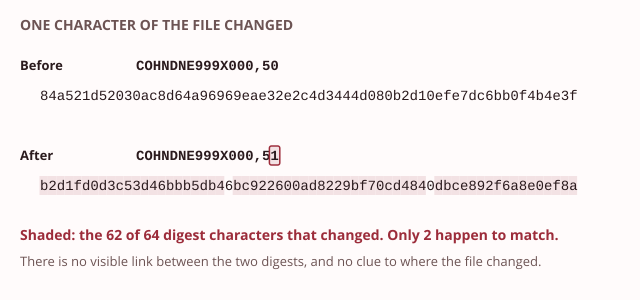
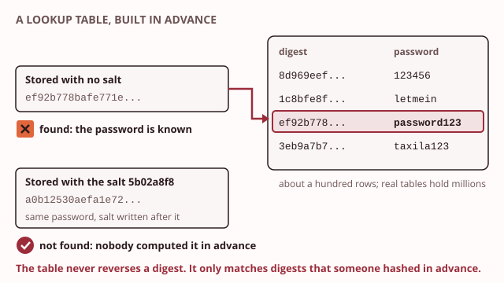
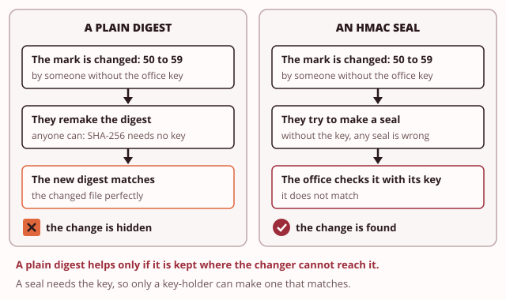

# Day 3: Fingerprints: hashing and integrity

These notes cover the Day 3 morning: how a short fingerprint can show whether data has changed, even by one character. They also show why a fingerprint cannot be turned back into the data, how passwords should be stored, and what a keyed seal proves.

> **Recall.** Integrity means data has not been changed without permission.

Last semester a student's final grade at Taxila was found to be higher than the lecturer had entered. Nothing showed when it changed. The Registrar now wants every published results file to reveal any change, even one mark. The Head of IT (information technology) has a second worry. Staff and students reuse their passwords. If the database of the SIS (Student Information System) were stolen tonight, what would the thief read?

Both answers rest on one tool. On Day 2 you used [SHA-256](../../glossary.md#sha-256) (Secure Hash Algorithm, 256 bits) as a recipe: it turned your index number into a key of exactly the right length. Today you learn what SHA-256 is, and why it is one of the most useful tools in security. Item 5 on Taxila's security register is the SIS password store, and item 6 is results file integrity. You build both this afternoon.

## 1. A fingerprint for any data

Try the demo first: [Any size in, one size out](artefacts/fingerprint-any-size.html). Choose an input, from one letter to a whole megabyte, or type your own. Watch the length of the result.

A **[hash function](../../glossary.md#hash-function)** takes an input of any size and returns a short value of fixed length. That value is called the **[digest](../../glossary.md#digest)**, or simply the hash. Two rules make it useful:

- **The length never changes.** One letter, a page or a whole film all give a digest of the same length.
- **The same input always gives the same digest.** On any computer, today or in ten years, the same bytes give the same digest.

The hash function you meet most often is **SHA-256**, the Secure Hash Algorithm at 256 bits. Its digest is 256 bits long. That is 32 bytes, which is written as sixty-four hexadecimal characters. For example:

| Input | SHA-256 digest |
|---|---|
| `a` | `ca978112ca1bbdcafac231b39a23dc4da786eff8147c4e72b9807785afee48bb` |
| `Taxila` | `e2122a5da93a5d7321d9e2a87b7440fa8c0d66c42c89637c6a382ce094d25200` |

A digest is a fingerprint of the data. It identifies the data, but it does not hide it. The data itself is not changed or locked by hashing: it stays exactly as readable as before. So a hash function is not a kind of encryption. It does a different job: it lets anyone check that data is still the same.

That is why hash functions appear all over security. A download site prints the digest of each file, so you can check your copy. Systems store the digest of each password, not the password, as section 4 shows. And on Day 4 you sign a digest, not a whole document.

> **You already know this.** A fingerprint identifies a person. Police can match a fingerprint to one person, even among millions. But nobody can grow the person back from the fingerprint.
>
> *Mapping:* the fingerprint = the digest; you cannot grow a person back from a fingerprint = you cannot reverse a hash.

> **Taxila.** A published results file carries its digest so anyone can check it is unchanged.

> **Common mistake.** "A longer file gives a longer digest." The digest is a fixed length whatever the input size. One letter and a whole megabyte both give sixty-four characters with SHA-256.

> **Quick check.** The Registrar publishes two results files, each with its SHA-256 digest: Colombo's file is three megabytes and Kandy's is thirty kilobytes. Which digest is longer?
>
> - [ ] Colombo's, because its file is a hundred times larger
> - [x] Neither: both digests are sixty-four characters
> - [ ] Kandy's, because a small file needs more filling
>
> **Why:** A hash function always returns the same length, whatever the size of its input. Expecting the larger file to have the longer digest is tempting, but a digest is a fingerprint, not a copy.

## 2. One change, a whole new fingerprint

Try the demo first: [One change, a new fingerprint](artefacts/avalanche.html). Change a single character of a results line and compare the two digests.

A good hash function has the **[avalanche effect](../../glossary.md#avalanche-effect)**: change one character of the input, and the digest changes completely. Here is one line of a results file, before and after one mark changed:

| Line | SHA-256 digest |
|---|---|
| `COHNDNE999X000,50` | `84a521d52030ac8d64a96969eae32e2c4d3444d080b2d10efe7dc6bb0f4b4e3f` |
| `COHNDNE999X000,51` | `b2d1fd0d3c53d46bbb5db46bc922600ad8229bf70cd4840dbce892f6a8e0ef8a` |

One character of the input changed. In the digests, 62 of the 64 characters are different, and 127 of the 256 bits flipped. About half the bits flip on every change, and you cannot predict which.

There is no visible relationship between the two digests. They do not "look close" because the inputs were close. So nobody can study a digest and learn what the input was, or how much of it changed.

This is what makes a digest a tamper check. Record the digest of a file when you publish it. Later, take the digest again. If even one character has changed, the two digests are completely different. If they match, the file is the same, byte for byte.

The check works only while the recorded digest is safe. Someone who can change the file and also change the recorded digest can hide the change. So the recorded digest must be kept where the changer cannot reach it. Section 5 shows a way to seal it.

> **You already know this.** One wrong note in a song you know makes the whole tune sound wrong at once. You may not know which note was wrong, but you hear that something changed.
>
> *Mapping:* one changed note = one changed character; the whole tune sounds different = the whole digest changes.

> **Taxila.** A grade file altered by one mark has a completely different digest.

> **Quick check.** The digest recorded when a results file was published now differs from the file's digest in 61 of its 64 characters. How much of the file has changed?
>
> - [ ] Most of the file, because most of the digest changed
> - [ ] Three characters, the ones that still match
> - [x] You cannot tell: one character or the whole file
>
> **Why:** The avalanche effect makes any change, however small, alter about half of the digest, so the digest shows that the file changed but not how much. Reading the size of the change from the digest is tempting, but there is no link between the two.

## 3. One way only

Try the demo first: [One way only](artefacts/one-way-street.html). Encrypt a line and decrypt it with the key, then try to get an input back from its digest.

> **Recall.** A key makes encryption reversible; hashing, as this day shows, works the other way.

A hash function is built so that it can only be run forwards. Two properties describe this:

- **[Preimage resistance](../../glossary.md#preimage-resistance).** Given a digest, you cannot find an input that made it. There is no way to run the hash backwards.
- **[Collision resistance](../../glossary.md#collision-resistance).** You cannot find two different inputs that give the same digest. A pair that does is called a **collision**.

Here is the difference from Day 2:

| | Encryption | Hashing |
|---|---|---|
| Key | yes | no |
| Can you get the input back? | yes, with the key | no, never |
| Length of the output | grows with the input | always the same |
| What it protects | confidentiality: who can read | integrity: whether it changed |

If a digest cannot be reversed, can it still be guessed? Yes, but only in one way: take a likely input, hash it, and see whether the digest matches. That works for short, common inputs such as poor passwords. Section 4 shows what that means for password storage, and how to stop it.

Hash functions grow old. A hash is retired once researchers can find collisions for it, because then two different files could carry the same fingerprint.

| Hash function | Digest length | Status at the time of writing |
|---|---|---|
| **Message Digest 5 (MD5)** | 128 bits, 32 hexadecimal characters | deprecated: collisions are easy to find |
| **Secure Hash Algorithm 1 (SHA-1)** | 160 bits, 40 hexadecimal characters | deprecated: collisions have been found, and the United States standards body has said it has reached the end of its useful life |
| **SHA-256** | 256 bits, 64 hexadecimal characters | the current choice |

You can tell these three apart by the length of the digest alone. If a system stores a 32-character digest, it is probably using MD5, and it needs to change.

> **You already know this.** A paper shredder turns a page into strips. The strips are real and they came from that page, but nobody can put the page back together from them.
>
> *Mapping:* the shredder = the hash; you cannot reassemble the page = preimage resistance.

> **Taxila.** Once Taxila hashes its passwords, a stolen database would reveal digests, not passwords.

> **Common mistake.** "A hash is a kind of encryption you can undo." A hash cannot be reversed; there is no key that opens it. Encryption keeps data secret and gives it back to the key-holder. Hashing keeps nothing secret and gives nothing back.

> **Quick check.** The Head of IT says: "We keep SHA-256 digests of the SIS passwords. If a lecturer forgets a password, we decrypt the digest with our key." What is wrong?
>
> - [x] A digest has no key and cannot be turned back into a password
> - [ ] SHA-256 is deprecated, so the key no longer opens it
> - [ ] Nothing: a key opens a digest, as it did on Day 2
>
> **Why:** Hashing has no key and no reverse; the system can only check a typed password against the digest, so a forgotten password must be replaced. Day 2's key is tempting, but that key belonged to encryption, which hashing is not.

## 4. Storing passwords safely

Try the demo first: [A pinch of salt](artefacts/salt-shaker.html). Choose a common password and look its digest up in a table. Then give two staff the same password with two different salts, and look again.

> **Recall.** Only encryption needs a key, and whoever holds the key can reverse it.

A system must check your password every time you sign in, but it should never keep the password itself. If it did, anyone who stole the database, or any staff member who could read it, would have every password. And because people reuse passwords, those passwords would open other accounts too.

So a system stores a digest of each password instead. When you sign in, it hashes what you typed and compares the two digests. If they match, you typed the right password. The password itself is never stored.

**Unsalted digests are not enough.** Remember that a digest can be guessed by hashing likely inputs. Attackers do this in advance. They take a list of common passwords, called a **dictionary**, hash every word, and keep the results in a table. A **rainbow table** is a very large table of this kind, built in advance and stored in a compact form. Any such table of digests computed in advance is a **[lookup table](../../glossary.md#lookup-table)**. Given a stolen digest, they look it up. If a common password made it, the table matches it at once.

The table does not reverse the hash. It only matches a digest against digests computed in advance. But the effect is the same for a common password: it is found.

**A salt defeats the table.** A **[salt](../../glossary.md#salt)** is a value, different for every user, that is added to the password before hashing. Two staff who chose the same password now have different stored values, because their salts differ. No table holds those values, because nobody could compute them in advance: they would need a separate table for every salt, which means for every user.

The salt is stored in plain sight, beside the digest. It does not need to be secret. Its job is to make every stored value different, not to hide anything. A stored row looks like this:

| User | Salt | Stored digest of password + salt |
|---|---|---|
| `lecturer01` | `5b02a8f8` | `a0b12530aefa1e72505b5ef0afb82d54e8fc432477b2ade85f09d1174e42b535` |
| `registrar` | `962bb99b` | `f7bbb48d2b7e71a3f0d6310b067b2e257c3a5528987183ef5d92bd7ab46c0e5b` |

Both users above chose the same poor password, `password123`. You cannot tell that from the store. In a real system, each salt is chosen at random when the password is set. In this afternoon's lab, your salts come from your index number, so your lecturer can check your values.

**Speed is a weakness here.** SHA-256 is fast, which is good for checking files. For passwords it is a problem, because a fast hash lets a guesser try millions of passwords a second. So passwords should be stored with a **[slow password hash](../../glossary.md#slow-password-hash)**, made slow on purpose. Three are in common use: **bcrypt**, **Argon2**, and the **Password-Based Key Derivation Function 2 (PBKDF2)**. Each repeats its work many times. At the time of writing, guidance for PBKDF2 with SHA-256 is about 600,000 rounds. A real user signs in once and waits a fraction of a second. A guesser pays that same wait for every single guess.

A **[pepper](../../glossary.md#pepper)** is one further secret value, the same for every user, that is added before hashing. Unlike the salt, it is kept apart from the database, for example in the server's own settings. Then a stolen database alone is not enough to test guesses.

**Encryption is the wrong tool for passwords.** If passwords were encrypted, they could be decrypted, and whoever held the key could read every one. The key would sit on the same server, so stealing the server would mean stealing the key. A hash has no key to steal.

What a thief who copies the password store would get:

| How the store holds passwords | What a thief who copies the store gets |
|---|---|
| plaintext | every password, at once |
| encrypted | every password, as soon as they find the key |
| unsalted digests | every common password, from a lookup table; identical digests show who shares a password |
| salted digests | nothing from a table; each guess must be made for one user at a time |
| salted, slow digests | the same, and every guess is slow |

> **You already know this.** Two cooks follow the same recipe. Each adds a different secret spice of their own. The two dishes now taste different, although the recipe was the same.
>
> *Mapping:* the recipe = the password; the unique spice = the salt; the dishes now taste different = the stored digests differ.

> **Taxila.** Two staff who both chose the same password must not share a stored value.

> **Common mistake.** "Hashing a password is enough without a salt." Without a salt, a lookup table reverses common passwords at once. And two people with the same password have the same stored value, for anyone to see.

> **Quick check.** A tea estate's payroll office stores unsalted SHA-256 digests of its clerks' passwords. In a copy of the store, two clerks have the same digest. What has the copy revealed?
>
> - [ ] Nothing, because a digest cannot be reversed
> - [x] That the two share a password, which a lookup table may then name
> - [ ] Both passwords, because two matching digests can be decrypted together
>
> **Why:** With no salt, the same password always gives the same digest, so matching digests show a shared password, and a common one is found in a table. Answering "nothing" is tempting, but a table matches digests without reversing them.

## 5. A seal both sides can check

Try the demo first: [A keyed seal](artefacts/hmac-seal.html). Seal a results file, check it with the key, change a mark, and then try to make a seal without the key.

> **Recall.** Non-repudiation means a person cannot later deny an action, because the record proves it was theirs.

> **Recall.** Symmetric encryption shares one secret key between both sides.

Section 2 left a problem. Anyone can compute a digest, including the person who changed the file. If they can replace both the file and its recorded digest, the check is fooled.

A **[hash-based message authentication code (HMAC)](../../glossary.md#hmac)** solves this. It is a keyed hash for message authentication: it mixes a secret key with the message, then hashes the result. The output is called a seal. Only someone who has the key can make a seal, and only someone who has the key can check one. Change the message, and the seal no longer matches. Make a seal without the key, and it does not match either.

An HMAC seal proves two things:

- the message has not changed since it was sealed;
- it was sealed by someone who holds the key.

It does not hide anything. The message beside the seal stays readable, just as a file beside its digest does.

There is a limit, and it matters on Day 4. Both sides share the same key, as in symmetric encryption. So when the examinations office in Colombo and the office in Kandy both hold the key, a valid seal could have been made by either of them. The seal proves that a key-holder sealed the message, not which one. That means it gives no non-repudiation. On Day 4 you meet a signature, made with a private key that only one person holds. That proves which one.

| | A plain digest | An HMAC seal | Day 4: a signature |
|---|---|---|---|
| Who can make it? | anyone | only the key-holders | only the private-key holder |
| Shows the message is unchanged? | only if the digest is kept safe | yes | yes |
| Shows who made it? | no | a key-holder, not which one | yes, which person |

> **You already know this.** A tamper strip on a parcel needs a stamp. The sender and the receiver each hold a copy of the stamp. A strip with the right stamp shows the parcel was sealed by a stamp-holder and not opened since.
>
> *Mapping:* the shared stamp = the secret key both sides hold; a matching strip = the keyed hash verifies; either side could have stamped it = no non-repudiation.

> **Taxila.** A results file carries a keyed-hash seal so the examinations office knows a key-holder in the office produced it unchanged.

> **Common mistake.** "A keyed-hash seal proves which person sent the message." Both sides share the key, so it proves only that a key-holder sent it. A signature, not a keyed hash, proves which one.

> **Quick check.** The examinations offices in Colombo and Kandy share one HMAC key. A results file arrives with a seal that checks correctly. What does the seal prove?
>
> - [ ] That the Colombo office sealed it
> - [ ] That nobody has read the file on the way
> - [x] That it is unchanged and a key-holder sealed it
>
> **Why:** Both offices hold the key, so either could have made the seal, and the file was never hidden. Naming Colombo is tempting, but only a signature with a private key that one person holds shows which one.

## Before the lab

This afternoon you fingerprint your own results file, change one mark, and watch the whole digest change. Then you salt a password and see a lookup table find the unsalted digest but not yours, and you time a fast hash against a slow one. Bring these notes, open at sections 2 and 4. Full-tier students: start your Kali virtual machine before the session, so the snapshot is quick.

## Reading

- Pfleeger, C. P., Pfleeger, S. L. and Coles-Kemp, L., *Security in Computing*, 6th ed., chapter 12, section 12.4, message digests; then section 2.1, authentication, on how passwords are stored. The 4th edition, by the first two authors, covers hash functions in chapter 2 and passwords under user authentication in chapter 4.

Next: Day 4, signatures, certificates and secure web traffic. You sign a digest with a key that only you own.
