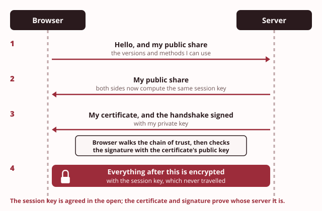

# Day 4: Signatures, certificates and TLS

These notes cover the Day 4 morning. A key that only you hold can sign a document, so anyone can check who wrote it and that it is unchanged. They then show how a certificate tells you whose key you are holding, and what the padlock in your browser really proves.

> **Recall.** A hash is a fingerprint that changes on any edit.

> **Recall.** A public and private key pair lets anyone close a padlock only you can open.

> **Recall.** Accountability means being able to prove who did something.

Employers who receive a Taxila transcript often phone the Registrar to ask whether it is genuine. That is slow, and a phone call proves little. The Registrar wants transcripts that an employer can check alone, in seconds. Last semester there was a second problem. Several staff received an email that seemed to come from the Registrar, with a link to a page that looked like the college's own. Two people typed in their bank details.

Both problems are about proof of origin. Can a document prove who made it? Can a web page prove whose it is? Today you join three things you already have, fingerprints, key pairs and accountability, to answer both. Item 7 on Taxila's security register is signed transcripts, and item 8 is the portal certificate and TLS (Transport Layer Security). You build both this afternoon.

## 1. Signing with the private key

Try the demo first: [Sign, then verify](artefacts/sign-verify.html). Make a key pair, sign a transcript line, and check the signature with the public key.

On Day 3 you met a keyed seal, the [hash-based message authentication code (HMAC)](../../glossary.md#hmac). It shows that a key-holder made the seal, but both sides hold the same key, so it cannot show which one. A signature fixes that, because it uses a key that only one person holds.

> **Recall.** Non-repudiation means a person cannot later deny an action, because the record proves it was theirs.

A **[digital signature](../../glossary.md#digital-signature)** is made in two steps:

1. **Hash the document.** Take its digest with SHA-256 (Secure Hash Algorithm, 256 bits). The digest is short, whatever the size of the document.
2. **Sign the digest with your private key.** The result is the signature. It travels beside the document.

To **verify**, anyone takes the document they received and hashes it again. Then they check the signature against that digest, using your public key. If the check passes, two things are proved:

- **Origin.** The signature was made with your private key. Nobody else holds it.
- **Integrity.** The document is the same, byte for byte, as when you signed it.

The document is not hidden. It stays as readable as before. A signature proves who wrote it and that it is unchanged; it keeps nothing secret.

**This is a different job from Day 2.** On Day 2 you encrypted a message to someone else's public key, so that only their private key could open it. That gave secrecy. Signing uses your own private key, and anyone can check it with your public key. That gives proof, not secrecy. The two jobs use the keys in opposite ways:

| Job | Who uses which key | What it gives |
|---|---|---|
| Encrypt to someone (Day 2) | you use **their public key**; they open it with **their private key** | secrecy: only they can read it |
| Sign (today) | you use **your private key**; anyone checks with **your public key** | proof of origin and integrity, and no secrecy |

Because only you hold your private key, only you could have made the signature. So you cannot later deny that you signed. That is non-repudiation, the property you met on Day 1, and the keyed seal could not give it.

| | A plain digest | An HMAC seal | A signature |
|---|---|---|---|
| Who can make it? | anyone | only the key-holders | only the private-key holder |
| Who can check it? | anyone | only the key-holders | anyone with the public key |
| Shows the document is unchanged? | only if the digest is kept safe | yes | yes |
| Shows which person made it? | no | no: either key-holder | yes: non-repudiation |

> **You already know this.** In the past, an official sealed a letter with hot wax and pressed it with a stamp that only they owned. Anyone who received the letter could recognise the seal. Nobody else could make it, because nobody else held the stamp.
>
> *Mapping:* the stamp only you own = your private key; others recognising the seal = verifying with your public key; nobody else holds the stamp = non-repudiation.

> **Taxila.** A transcript the Registrar signs so an employer can trust it without phoning the college.

> **Common mistake.** "Signing hides the document." A signature proves who wrote it and that it is unchanged; it does not hide it. If a document must also be secret, it is encrypted as well, as on Day 2.

> **Quick check.** The Registrar signs a transcript and sends it to an employer in Kandy. Which key does the employer use to check the signature?
>
> - [ ] The employer's own private key
> - [ ] The Registrar's private key, sent with the transcript
> - [x] The Registrar's public key
> - [ ] A key the employer and the Registrar both share
>
> **Why:** The Registrar signs with a private key that never leaves the office, and anyone checks with the matching public key. A shared key would make it a keyed seal, which cannot show that the Registrar, and not the employer, made it.

## 2. Tampering breaks the signature

Try the demo first: [One edit, a broken signature](artefacts/tamper-breaks-signature.html). Change one character of a signed transcript and verify it again.

> **Recall.** The avalanche effect: one changed character gives a completely different digest.

Suppose someone changes a signed transcript by one character, a B to an A. The person who checks it hashes the changed document. Because of the avalanche effect, that digest is completely different from the one the Registrar signed. So the signature no longer matches, and verification fails.

This works for every change, however small: one mark, one space, one letter. So a valid signature proves that the document is unchanged since it was signed. A failed signature tells you that something changed, though not what or how much.

The person who changed the document cannot repair the signature either. To make a new valid signature, they would need the Registrar's private key. Signing with their own key would not help: the employer checks with the Registrar's public key, and a signature made with any other private key fails that check.

A signature still does not hide the content. Anyone can read a signed transcript. What they cannot do is change it unnoticed.

> **You already know this.** A letter arrives with its wax seal cracked across the middle. You may not know who opened it or what they did, but you know at once that it was opened.
>
> *Mapping:* the cracked wax = a failed verification; you know the envelope was opened = you know the file changed.

> **Taxila.** An altered transcript no longer verifies against the Registrar's public key.

> **Quick check.** A microfinance cooperative signs each loan statement it sends to its village agents. One agent's copy fails verification. What does the failure tell the cooperative?
>
> - [x] The statement changed after signing, or it was not signed with the cooperative's key
> - [ ] Someone has read the statement on the way
> - [ ] Exactly which figure in the statement was changed
>
> **Why:** A failed check means the digest no longer matches the signed one, or the signature was made with another key. It cannot say what changed, and reading was never prevented: a signature does not hide anything.

## 3. A certificate is a signed identity

Try the demo first: [A certificate is a passport](artefacts/certificate-passport.html). Open a real certificate and read each field beside the page of a passport.

> **Recall.** On Day 2, the key distribution problem was how to get a key safely to the other side.

Signatures leave one question open. To check the Registrar's signature, the employer needs the Registrar's public key. A public key is not secret, so the Registrar can publish it. But how does the employer know that the key really belongs to the Registrar? Someone could publish their own key and call it "the Registrar's key". Every signature they made would then verify.

The answer is a **[certificate](../../glossary.md#certificate)**. A certificate is a small file that says "this public key belongs to this name", and it is signed by someone you already trust. Certificates follow a standard format called **X.509**. Every X.509 certificate carries these fields:

| Field | What it holds | The passport page |
|---|---|---|
| Subject | the name the certificate is for, such as `sis.taxila.example` | your name and photo |
| Issuer | who signed the certificate | the government that issued the passport |
| Validity | the first and last day it may be trusted | the date of issue and the date of expiry |
| Public key | the subject's public key | your photo, which links the page to your face |
| Signature | the issuer's signature over all the fields above | the official stamp |

The issuer is a **[certificate authority (CA)](../../glossary.md#certificate-authority)**. This is a trusted third party whose job is to check that a key belongs to a name, then vouch for it by signing. If anyone changes a single field, such as the subject's name, the authority's signature no longer verifies. So a certificate cannot be edited unnoticed, for the same reason a signed transcript cannot.

A certificate is public, and it holds only a public key. On its own it keeps nothing secret. It is a statement of identity that anyone can read and check.

> **You already know this.** A passport is issued by a government. Border officers in other countries trust it, although they have never met you, because they trust the government that issued it and can check its stamp.
>
> *Mapping:* your photo and name = the subject and public key; the issuing authority = the certificate authority; the official stamp = the authority's signature.

> **Taxila.** The portal's certificate says the key really belongs to the `taxila.example` domain.

> **Quick check.** The Head of IT (information technology) says: "Now that `sis.taxila.example` has a certificate, anything sent to it is secret." What is wrong with this?
>
> - [ ] Nothing: a certificate encrypts the traffic to the site
> - [x] A certificate only links a public key to a name; secrecy comes from the encrypted connection
> - [ ] A certificate keeps traffic secret only after the authority signs it
>
> **Why:** A certificate is a signed, public statement of identity. It is used to set up an encrypted connection, as section 5 shows, but on its own it hides nothing. Thinking the certificate itself encrypts is tempting, because the two always appear together.

## 4. The chain of trust

Try the demo first: [Follow the chain of trust](artefacts/chain-of-trust.html). Follow a certificate up to a root your browser trusts, then remove one link and watch the browser refuse.

Who checks the authority? Another authority, and so on, until the chain reaches an authority your browser already trusts. This is the **[chain of trust](../../glossary.md#chain-of-trust)**:

- **End-entity certificate.** The certificate for the site itself, such as `sis.taxila.example`. It is signed by an intermediate authority.
- **Intermediate certificate.** The certificate of the authority that signed the site's certificate. It is signed by a root.
- **[Root certificate](../../glossary.md#root-certificate).** The certificate of an authority at the top of the chain. Your browser and your operating system come with a list of root certificates they already trust, called the **trust store**.

When you open a secure site, your browser walks the chain. It checks the site's certificate with the intermediate's public key, and the intermediate's certificate with the root's public key. Then it checks that the root is in its trust store. If every link holds, the browser trusts the site's key. If any link fails, or the chain does not end at a root in the store, the browser warns you and stops.

Roots are kept very safe, often offline, because so much depends on them. Intermediates do the daily signing, so a problem with one intermediate does not damage the root.

**A self-signed certificate.** Anyone can make a certificate and sign it with their own key. Then the issuer and the subject are the same name. This is a **[self-signed certificate](../../glossary.md#self-signed-certificate)**. It is a valid certificate, in the correct format, but nobody else vouches for it. It is in no trust store, so a browser that meets it on a website warns you.

**Asking for a certificate.** To get a certificate from an authority, the owner of a site first makes a key pair. Then they send a **[certificate signing request (CSR)](../../glossary.md#certificate-signing-request)**: a message holding their public key and the name they want, signed with their private key. The authority checks that the name really belongs to them, then signs the certificate.

**Certificates do not last for ever.** Every certificate has an end date, after which browsers refuse it. At the time of writing, a certificate from a public authority may last at most 200 days, and that limit is set to fall further. Short lives limit the damage if a key is stolen without anyone noticing. An authority can also **revoke** a certificate before its end date, for example when its private key has leaked. Browsers then stop trusting it.

> **You already know this.** You apply for a job and bring a reference letter. The employer does not know the writer. But the writer's letter is vouched for by someone the employer already trusts. A letter you wrote about yourself would carry no weight at all.
>
> *Mapping:* the letter = the certificate; the trusted referee = the root authority in your browser; a stranger vouching for themselves = a self-signed certificate.

> **Taxila.** A self-signed certificate on the portal makes the browser warn, and that warning is the lesson.

> **Common mistake.** "A certificate error is a browser bug to click past." It means the identity could not be trusted, so stop. The page may be a copy, and anything you type there may go to someone else. Only on a machine you control, with a certificate you made yourself and have checked, is it safe to continue.

> **Quick check.** A student opens `https://sis.taxila.example` and the browser shows a full-page warning: the certificate's issuer is the same as its subject. What is the right call?
>
> - [ ] Continue: self-signed certificates are broken, so the warning means nothing
> - [ ] Continue: the address starts with https, so the page is safe
> - [x] Stop, and report it to the Head of IT: nobody vouches for this key
>
> **Why:** Issuer equal to subject means a self-signed certificate. It is a valid certificate, but no authority in the trust store vouches that the key belongs to the college, so the page could be a copy.

## 5. Transport security and the padlock

Try the demo first: [What the padlock proves](artefacts/padlock-truth.html). Compare a form sent over plain web with the same form sent over secure web, then open a look-alike site that has a valid padlock.

> **Recall.** The hybrid pattern uses an asymmetric method to set up a fast symmetric key, by carrying it or by agreeing it in the open.

Ordinary web traffic uses the Hypertext Transfer Protocol (HTTP). Everything it carries, including what you type into a form, travels as plain text. Anyone who can see the traffic, on a shared Wi-Fi network for example, can read it.

**[Hypertext Transfer Protocol Secure (HTTPS)](../../glossary.md#https)** is the same HTTP, wrapped inside **[TLS](../../glossary.md#tls)**, the Transport Layer Security you met at the start. TLS is where today's ideas come together. Before any page is sent, the browser and the server run a short **handshake**. In TLS 1.3, the current version, it works like this:

1. **The browser says hello.** It sends the versions and methods it supports, and a public share for agreeing a key. This is the Day 2 idea of agreeing a key in the open, called Diffie-Hellman.
2. **The server answers with its own share.** Each side combines its own secret with the other side's share. Both arrive at the same **[session key](../../glossary.md#session-key)**, a fast symmetric key, although the key itself never travelled.
3. **The server proves who it is.** It sends its certificate, and signs the handshake with its private key. The browser walks the chain of trust, then checks the signature with the public key from the certificate. Only the real owner of that key could have signed.
4. **Both sides finish.** From now on, every byte travels encrypted with the session key.

So TLS uses each tool from Days 2 to 4. Asymmetric methods agree the key and prove identity. A fast symmetric key carries the data. Signatures and certificates bind the key to the site's name.

**What the padlock proves.** When the handshake succeeds, the browser shows a padlock or a similar sign. It proves two things: the connection is encrypted, and an authority has vouched that the site's key belongs to the name in the address bar. It does not prove that the site is honest, that the name is the one you meant to visit, or that the operator will look after your data. A look-alike page with a slightly different name can get a valid certificate for its own name, and show a padlock.

**Three further protections.**

- **[HTTP Strict Transport Security (HSTS)](../../glossary.md#hsts).** A site can tell the browser: "only ever connect to me over HTTPS". The browser remembers, and refuses plain HTTP to that site from then on, even if someone tries to send it there.
- **Old versions are retired.** At the time of writing, TLS 1.0 and 1.1 are deprecated, and a server should not accept them. TLS 1.3 is current, and many servers also still accept 1.2.
- **[Certificate pinning](../../glossary.md#certificate-pinning).** An application can be built to accept only one particular certificate or key for its own server, even if another authority vouches for a different one. At the time of writing this is used mainly by mobile apps, such as banking apps; browsers no longer offer it to websites.

> **You already know this.** A government sends papers to its embassy in a diplomatic pouch. The pouch is sealed, so nobody on the way can read the papers, and it is addressed to an office whose identity is verified. But a sealed pouch sent to the wrong office is still sealed.
>
> *Mapping:* the seal = the encryption; the verified address = the certificate's identity; a sealed pouch to the wrong office = a valid padlock on a bad site.

> **Taxila.** The fake message linked to a look-alike page; a padlock there would still not make it Taxila.

> **Common mistake.** "The padlock means the site is trustworthy." It proves an encrypted channel and a vouched identity, not a safe operator. Read the name in the address bar: the padlock only vouches for that name.

> **Quick check.** A courier company's tracking site shows a padlock. A customer receives a text message with a link to a site whose name differs by a few letters, and that site also shows a padlock. What do the two padlocks tell the customer?
>
> - [ ] Both sites belong to the courier company, because both are vouched for
> - [ ] The second site is safe, because the padlock means the operator was checked
> - [x] Both connections are encrypted, and each name's key is vouched for, but not who runs the second site
>
> **Why:** An authority vouches only that a key belongs to the name in the certificate. Anyone can get a certificate for a name they control, so the padlock on a look-alike name proves an encrypted channel to the wrong place.

## Before the lab

This afternoon you make your own key pair, sign your index number, and watch one edit break the signature. You then read a certificate's fields and walk a real site's chain of trust to its root. Last, you see what a form looks like on the wire, over plain and over secure web. Bring these notes, open at sections 1 and 4. Full-tier students: start your Kali virtual machine before the session.

## Reading

- Pfleeger, C. P., Pfleeger, S. L. and Coles-Kemp, L., *Security in Computing*, 6th ed., chapter 2, section 2.3, on certificates, trust and digital signatures; then chapter 12, section 12.5, digital signatures. The 4th edition, by the first two authors, covers digital signatures and certificates in chapter 2.

Next: Day 5, identity and access. You meet three processes, authentication, authorisation and accounting, and see how Taxila decides who may do what.
