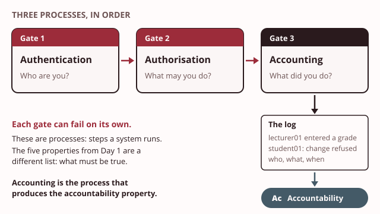

# Day 5: Who are you, and what may you do

These notes cover the Day 5 morning. They separate three processes that every system runs when someone signs in: proving who you are, deciding what you may do, and recording what you did. They then show how to give each account only what its job needs, and how to strip a server down to what it uses.

> **Recall.** On Day 1 you met five properties: confidentiality, integrity, availability, authenticity and accountability.

> **Recall.** A stored password is kept as a salted digest, not as plaintext.

> **Recall.** A signature proves which person acted, because only that person holds the private key.

Last semester a student's final grade in the Student Information System (SIS) was found to be higher than the lecturer had entered. The SIS showed the new grade, but not who had changed it, or when. The Registrar's question has not changed since: "Can we prove who changed it?"

To answer it, Taxila needs three things to work together. The SIS must know who is signing in. It must allow each person only the actions their job needs. And it must keep a record of every change. Today you meet these as three processes. Item 9 on Taxila's security register is accounts, roles and multi-factor sign-in, and item 10 is the hardened server baseline. You build both this afternoon.

## 1. Authentication, authorisation and accounting

Try the demo first: [Three gates](artefacts/aaa-gates.html). Send each prepared user through the three gates and read the log each one leaves behind.

> **Recall.** Accountability means being able to prove who did something.

Every time someone uses a system, three separate processes run, in this order. Together they are called authentication, authorisation and accounting (AAA).

1. **[Authentication](../../glossary.md#authentication): who are you?** The system checks a claim of identity. You type `lecturer01` and a password, and the SIS checks the password against its salted digest. If they match, the SIS accepts that you are `lecturer01`.
2. **[Authorisation](../../glossary.md#authorisation): what may you do?** The system looks up what this identity is allowed to do. `lecturer01` may enter grades for the modules they teach, and nothing else.
3. **[Accounting](../../glossary.md#accounting): what did you do?** The system records each action: who, what, and when. "`lecturer01` changed a grade in module 2 from 61 to 64" is one line of accounting.

Each gate can fail on its own. A user can pass authentication and be refused at authorisation, because they are who they say they are but the action is not theirs to do. A system can authenticate and authorise perfectly and still keep no log. That was Taxila's case. Whoever changed the grade may well have signed in properly. Nobody can tell, because the third gate was missing.

**These three processes are not the five properties.** The properties from Day 1 describe what you want to be true of information: kept secret, unchanged, available, genuine, traceable. The processes are steps a system runs to get there. The names sound alike on purpose, and telling them apart is the point of today.

| | What it is | Example at Taxila |
|---|---|---|
| Authenticity (a property, Day 1) | the information or person is genuine | the transcript really came from the Registrar |
| Authentication (a process, today) | the step that checks a claimed identity | the SIS checks `lecturer01`'s password |
| Accountability (a property, Day 1) | an action can be traced to a person | the grade change can be pinned on one person |
| Accounting (a process, today) | the step that records each action | the SIS writes "who changed what, when" into its log |

Accounting is the process that produces the accountability property. Authentication is one of the ways you get authenticity, but not the only one: on Day 4 a signature gave a transcript authenticity with no sign-in at all.

> **You already know this.** At an airport, the passport desk checks that you are the person in the passport. At the boarding gate, a second officer checks that your boarding pass is for this flight. And the airline keeps a departure log of who boarded which plane. A valid passport does not get you on any plane you like.
>
> *Mapping:* the passport desk = authentication; the boarding gate = authorisation; the departure log = accounting.

> **Taxila.** The changed grade had no departure log, so no one could be held to account.

> **Common mistake.** "Authentication is the same as authenticity." Authentication is a process: the step that checks who you are. Authenticity is a property: the information or person is genuine. A process is something a system does; a property is something that is true or not.

> **Common mistake.** "The three processes are the five properties." They are separate lists, taught on different days. The five properties (confidentiality, integrity, availability, authenticity, accountability) say what must be true. The three processes (authentication, authorisation, accounting) are steps a system runs.

> **Quick check.** A Taxila student signs in to the SIS with the right password and tries to open another student's grades. The SIS refuses. Which process refused?
>
> - [ ] Authentication, because the student is not who they claim to be
> - [x] Authorisation, because the action is not one the student may do
> - [ ] Accounting, because the action was recorded
>
> **Why:** The right password means authentication passed: the SIS accepts who the student is. The refusal came at the next gate, which decides what this identity may do. Accounting may record the refused attempt, but recording never refuses anything.

## 2. Factors and multi-factor sign-in

Try the demo first: [Stack the factors](artefacts/factors-mfa.html). Replay a prepared list of leaked passwords against Taxila's sign-in page, then add factors and watch the log.

> **Recall.** A stored password is kept as a salted digest, not as plaintext.

Authentication checks evidence of who you are. Each kind of evidence is called an [authentication factor](../../glossary.md#authentication-factor). There are three kinds:

- **Something you know:** a password, a personal identification number (PIN), the answer to a question.
- **Something you have:** your phone with an authenticator app, a security key, a smart card.
- **Something you are:** a fingerprint, your face.

[Multi-factor authentication](../../glossary.md#multi-factor-authentication) (MFA) asks for two or more factors of different kinds. A password and a code from your phone is two factors: something you know and something you have. Two passwords are still one factor, because both are something you know.

The demo's six-digit code changes every 30 seconds. Your phone makes it from a secret key it holds and the current time, with the keyed hash you met on Day 3, the hash-based message authentication code (HMAC). The demo computes it with the browser's own Web Crypto. Someone who has only your password does not have the phone, so they cannot make the code.

Why does this matter so much? Salting protects passwords inside Taxila's database. It cannot protect a password that a person reuses. If a member of staff uses the same password on a shopping site, and that site leaks its list, the pair of email address and password is now public. **[Credential stuffing](../../glossary.md#credential-stuffing)** is the automated replay of such leaked pairs against other sites, one after another. It needs no skill: wherever a person reused the password, the pair works.

A defender sees credential stuffing in the sign-in log: many sign-ins, from few places, for many different accounts, each tried once or twice. Most fail. A few succeed, and those are the reused passwords. With a second factor switched on, even the pairs that match stop at the next step, because the stolen list holds passwords, not phones.

> **You already know this.** Some office doors need both a key and a code typed on a keypad. If you find someone's key in the car park, you still cannot open the door. If you see someone type the code, you still cannot open it. You need both.
>
> *Mapping:* the key = something you have; the code = something you know; needing both = multi-factor authentication.

> **Taxila.** Staff reuse passwords, so the SIS needs a second factor.

> **Quick check.** An online bookshop sees 4,000 sign-in attempts in one hour, for 3,900 different customer accounts. Thirty succeed. Which control would have stopped those thirty?
>
> - [ ] Salting the stored passwords
> - [x] A second factor at sign-in
> - [ ] A longer minimum password length
>
> **Why:** The pattern, few tries for each of many accounts, is credential stuffing with a leaked list. The thirty pairs were correct passwords reused elsewhere, so salting and longer passwords change nothing for them. A second factor stops a correct password from being enough.

## 3. Access-control models

Try the demo first: [Who opens what](artefacts/access-models.html). Switch between the three models, then move a user between roles and watch which records open.

Authorisation needs rules: who may do what to which resource. An access-control model is the way those rules are set and changed. There are three you must know.

| Model | Who sets the rules | Example | Strength and weakness |
|---|---|---|---|
| [Discretionary access control](../../glossary.md#discretionary-access-control) (DAC) | the owner of each resource | a lecturer shares a folder of marks with a colleague | flexible, but access spreads as owners share freely |
| [Mandatory access control](../../glossary.md#mandatory-access-control) (MAC) | the system, by labels that users cannot override | exam papers labelled restricted can be opened only by accounts cleared for restricted | strict and consistent, but rigid and hard to run |
| [Role-based access control](../../glossary.md#role-based-access-control) (RBAC) | an administrator, who gives permissions to roles and assigns people to roles | the lecturer role may enter grades; `lecturer01` is assigned to it | easy to manage for many people, but roles need regular review |

This MAC is not the MAC inside HMAC from Day 3. Here the letters stand for mandatory access control; there they meant message authentication code.

In role-based access control, permissions are never given to a person directly. You design each role from a job: what does a lecturer need to do? Then you assign people to roles. When a person changes job, you move them to another role, and every permission moves with them. When 180 staff and 3,200 students use one system, this is the only model a team of four can keep in order.

> **You already know this.** Picture three buildings. In the first, each office owner lends keys to whoever they choose. In the second, the government gives each worker a clearance, and doors open only for the right clearance, whatever the owner wants. In the third, a job title opens certain doors: every cleaner's card opens the store cupboards, and every manager's card opens the meeting rooms.
>
> *Mapping:* the owner lending keys = discretionary access control; the government clearance = mandatory access control; the doors a job title opens = a role's permissions in role-based access control.

> **Taxila.** A lecturer role sees grades; a student role sees only its own record.

> **Quick check.** A school examinations board labels every paper "restricted" until release day. A senior examiner wants to share a restricted paper with a friend who helps with typing. The system refuses, although the examiner wrote the paper. Which model is the board using?
>
> - [ ] Discretionary access control
> - [x] Mandatory access control
> - [ ] Role-based access control
>
> **Why:** The rule came from a label the system enforces, and even the paper's author cannot override it. Under discretionary access control the author, as owner, could share it. The tempting answer is role-based, but no role was mentioned: the label alone decided.

## 4. Least privilege and separation of duties

Try the demo first: [Blast radius](artefacts/least-privilege-blast.html). Suppose one account's password leaks. Compare what that account can reach at three privilege settings.

[Least privilege](../../glossary.md#least-privilege) gives each account the minimum access its job needs, and for no longer than needed. A lecturer account can enter grades for the lecturer's own modules, not every module. An administrator account is used for administration only, not for reading email.

The reason is simple. Sooner or later a password leaks, by credential stuffing, by a fake email, or by a note on a desk. Whoever holds the stolen password gets exactly what the account was given, no more and no less. The area a stolen credential can reach is its blast radius. The smaller the privilege, the smaller the blast radius.

[Separation of duties](../../glossary.md#separation-of-duties) makes a second person approve a sensitive action, so that no one person can complete it alone. At Taxila, a released grade is sensitive: a lecturer may ask for a change, but a second person, the Registrar, must approve it. A single stolen password is then not enough to change a released grade, and an honest mistake is caught by a second pair of eyes.

| | Least privilege | Separation of duties |
|---|---|---|
| The question it asks | what is the least this account needs? | which actions must one person never do alone? |
| What it limits | how far one account reaches | what one person can finish alone |
| Taxila example | `lecturer01` enters grades only for their own modules | a released grade changes only with the Registrar's approval |

> **You already know this.** A hotel key-card opens only your own floor and your own room, and only for the nights of your stay. If you lose it, the finder cannot open every room in the hotel. And when a guest asks for a refund, the desk clerk cannot pay it alone: the manager must approve it.
>
> *Mapping:* your floor only = least privilege; only for your stay = no longer than needed; needing a manager to approve a refund = separation of duties.

> **Taxila.** A grade change needs a named editor and a second approver (register item 14 later).

> **Common mistake.** "Least privilege is about distrusting staff." It is about containing the damage when a credential is stolen. The Registrar trusts every lecturer. But a lecturer's password can leak without the lecturer doing anything wrong, and least privilege limits what the thief can do with it.

> **Quick check.** Taxila's Head of IT (information technology) uses one account for everything: email, the SIS and server administration. A fake email tricks him into typing that account's password on a look-alike page. What is the main problem?
>
> - [ ] The account had no second approver for reading email
> - [ ] The account's password was not salted
> - [x] The stolen password reaches every system, because one account holds every privilege
>
> **Why:** Least privilege would give him a plain account for email and a separate administrator account for servers. The stolen email password would then reach only email. Salting protects stored passwords, not one that is typed into a fake page.

## 5. Hardening a baseline

Try the demo first: [Harden the server](artefacts/hardening-checklist.html). Switch off the services nobody uses, close their ports, apply patches and turn on logging, and watch the server's open doors close.

A server's baseline is its agreed starting state. [Hardening](../../glossary.md#hardening) brings a server to a safe baseline. It covers five areas:

1. **Users and groups.** Only the accounts that are needed, each in the right group, with no forgotten accounts left over.
2. **File permissions.** Each file can be read or changed only by the accounts that need to. On Linux a mode such as `644` means the owner may read and write, and everyone else may only read.
3. **Unused services and open ports.** A service is a program that runs all the time and waits for requests, often on a network port. Every running service is a door. If nobody uses it, close it.
4. **Patching.** Install the updates that fix known weaknesses in the software you keep.
5. **Logging.** Record what happens, so that a change can be traced. This is the accounting process on a single server.

Everything an attacker could try to reach is the server's attack surface: its running services, open ports, accounts and writable files. Each service turned off and each port closed shrinks it. Notice that much of hardening is turning things off, not buying a product. It costs little, which matters to a team of four.

An audit tool compares a server with a good baseline and lists the differences as findings. This afternoon you use one, Lynis, on your own virtual machine, or read the same report in the browser.

> **You already know this.** Before you leave home for a long trip, you walk round and close the windows and doors you never use. You do not buy new locks for them; you just close them. Fewer open windows means fewer ways in.
>
> *Mapping:* an unused open window = an unused running service; closing it = hardening; all the windows and doors together = the attack surface.

> **Taxila.** The Head of IT's audit found services nobody used on the SIS server.

> **Quick check.** The Head of IT's audit lists four findings on the SIS server. Which one is fixed by turning something off?
>
> - [ ] The grade log does not record who made each change
> - [x] A file-sharing service runs, although nobody at Taxila uses it
> - [ ] Twelve packages have updates waiting
> - [ ] The lecturer accounts have no second factor
>
> **Why:** An unused service is fixed by stopping it and stopping it starting at boot: that shrinks the attack surface at no cost. The log needs turning on, the updates need installing, and the second factor needs adding; none of those is turned off.

## Before the lab

This afternoon your own server starts weak, with findings chosen from your index number. You read its audit, fix your findings one by one, and watch them clear. Then you design the SIS roles for a lecturer and a student, and name the action that needs a second approver. Bring these notes, open at sections 3, 4 and 5. Full-tier students: start your Kali virtual machine before the session. Before you leave today, form your group of four for the group exercise and agree its four roles.

## Reading

- Pfleeger, C. P., Pfleeger, S. L. and Coles-Kemp, L., *Security in Computing*, 6th ed., chapter 2, sections 2.1 and 2.2, on authentication and access control. Then chapter 5, section 5.1, security in operating systems, for this afternoon's hardening.

Next: Day 6, web applications. A web application signs people in and decides what they may do, and you see what goes wrong when it trusts what a user types.
