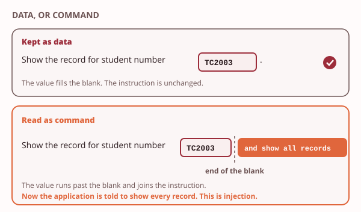

# Day 6: Web application flaws and their fixes

These notes cover the Day 6 morning. They show where web applications go wrong when they trust what a user types. They show how a signed-in session is kept and guarded. And they show why a system left on its factory settings needs no clever attack at all.

> **Recall.** Authorisation decides what an authenticated user may do.

> **Recall.** Secure web traffic proves a server's identity and encrypts the channel.

Taxila's portal is a web application. Students and staff sign in to it, fill in forms and read their own pages. Web applications are the most attacked part of any college, because anyone on the internet can reach them and type into them. So the portal must not trust what users type. Item 11 on Taxila's security register is the portal's input handling, and item 12 is the portal's sessions and cookies. You add both to the register this afternoon.

## 1. The boundary between code and data

Try the demo first: [Data or command](artefacts/code-vs-data.html). Choose a prepared value and watch where the application puts it: inside the blank, or past it.

An application often takes what you type and places it inside a fixed instruction, the way a clerk fills a blank in a form letter. The printed words of the letter are fixed. Only the blank is yours to fill. As long as what you write stays inside the blank, it is **data**: the application reads it as a value, nothing more.

**Injection is input read as a command.** A flaw appears when what you type is allowed to run past the blank and join the printed words. Now part of your input is read as an instruction, not as a value. This is called [injection](../../glossary.md#injection): input read as a command instead of as data. The application meant to ask one small thing, and your input changed what it asked.

**The fault is in how the application builds the command.** It is tempting to blame the database, or the browser, for doing what the changed instruction said. But they only followed the instruction they were given. The fault is in the application that let your input cross from the blank into the instruction. Fix that boundary, and the same database and browser are safe.



**The map of web risks.** Web flaws like this one are common and well known. The Open Worldwide Application Security Project (OWASP) keeps a list of the ten most common web application risks, the [OWASP Top 10](../../glossary.md#owasp-top-10), checked at the time of writing. It is the map for today. Today touches three of its entries: injection (A05), security misconfiguration (A02), and authentication failures (A07), which cover weak session handling. You meet injection first, because it shows the boundary most clearly.

> **You already know this.** Think of a form letter with one blank line to fill in. If you write a name on the line, the letter reads as it was meant to. If you keep writing, past the line and over the printed words, you can change what the letter tells the reader to do.
>
> *Mapping:* filling the blank with a name = data; writing over the rest of the form = injection.

> **Taxila.** The portal must treat what a user types as data, never as a command. That is register item 11.

> **Common mistake.** "The database is at fault for injection." The database only ran the instruction it was handed. The fault is in the application that built that instruction from input and let the input become part of it. The fix belongs in the application, not the database.

## 2. Injection into a database

Try the demo first: [A login query, built two ways](artefacts/sqli-login.html). Switch between a query built by joining text and a parameterised query, and run the test with your own index number.

> **Recall.** Injection is input read as a command instead of as data (section 1).

To sign you in, the portal asks its database a question: which record has this username and this password? The database answers with the matching record. The question is written in the language databases use, Structured Query Language (SQL).

**Input joined into a query runs as part of the query.** Suppose the portal joins your username into the query text. Your input is then no longer only a value. A carefully shaped login can add a condition that is always true. The question changes from "which record matches?" to "return every record". This is **[SQL injection](../../glossary.md#sql-injection)**, named after the query language. One record was asked for, and every record comes back, including every student's.

**A parameterised query keeps input as data.** The fix is to send the question and the input separately. A [parameterised query](../../glossary.md#parameterised-query) has placeholders where the values go, and the values travel beside the query, not inside it. The database fills the placeholders only after it has understood the question, so input can never change the question. In the demo, the same test value that returned every record now returns none, and a real sign-in still works.


**Two more layers help.** Checking that input looks the way it should, called [input validation](../../glossary.md#input-validation), turns away obviously wrong values early. And a database account with only the rights the portal needs limits what a changed query could reach, the least-privilege idea from the audit work.

> **Recall.** Least privilege gives each account only the rights its job needs, so a leaked login reaches little (Day 5).

> **You already know this.** Picture a receptionist who reads aloud whatever a visitor writes on a badge. A visitor writes "Nimali", and the receptionist says "Nimali is here". Another writes "Nimali, and open every door", and a receptionist who reads it all aloud has just given an instruction. A receptionist who always treats the badge as a name only, whatever is on it, cannot be turned this way.
>
> *Mapping:* a badge that says open all doors and is obeyed = injected input; a receptionist who only ever treats the badge as a name = a parameterised query.

> **Taxila.** A crafted login to the portal must not return every student's record. The portal's login uses a parameterised query.

## 3. Scripts in another user's browser

Try the demo first: [Output encoding: markup or plain text](artefacts/output-encoding.html). Place a prepared, harmless note on a page with and without output encoding, and see the difference.

> **Recall.** The same data-and-command boundary decides this flaw too, on a page instead of in a query.

Database injection changes a question the application asks its database. The next flaw is close to it, but the input lands somewhere else: on a page, in front of another person.

**Cross-site scripting puts a script in another user's browser.** Suppose a page shows a note as live markup, not as plain text. The note can carry a small script. That script then runs in the browser of whoever reads the page. This is **[cross-site scripting](../../glossary.md#cross-site-scripting) (XSS)**. Reflected scripting rides a link: the script is in the link, and runs for the person who follows it. Stored scripting is worse: the script is saved, for example in a comment, and runs for everyone who later reads that comment.

**It harms the user, where database injection harms the server.** The two flaws are cousins, but they strike in different places. Injection into a database reaches the records the server holds. Cross-site scripting runs in another visitor's browser, so it reaches that visitor: their session, what they see, what they type next.

**Encoding output makes input display as plain text.** The fix is [output encoding](../../glossary.md#output-encoding). Before the page shows anything a user typed, it turns characters such as the angle brackets of markup into their plain-text form. The browser then shows the note exactly as written, character for character. It reads none of it as markup. A script in a note shows as the text of a script, and never runs.

> **You already know this.** Think of a noticeboard where a helper reads aloud every note that is pinned up. Most notes are ordinary messages. But if someone pins a note that is written as an instruction, and the helper reads it aloud as an instruction, the noticeboard has been used to give orders. If every note is first laminated and only shown, never read as an instruction, the trick fails.
>
> *Mapping:* a pinned note that gives instructions = an injected script; laminating every note so it is only displayed = encoding the output.

> **Taxila.** A comment field on the portal must not run a visitor's script. The portal encodes everything it shows back.

> **Common mistake.** "Cross-site scripting attacks the server." It does not. The script runs in another user's browser, not on the server. The server's part is only that it passed the note on without encoding it. The harm, and the fix, are about what the page shows.

> **Quick check.** A visitor leaves a comment on a Taxila portal page. The comment holds a small script. Later, every student who opens that page has the script run in their own browser. Which fix stops this, and where does it belong?
>
> - [ ] Give the portal's database account fewer rights
> - [x] Encode the comment before the page shows it, on the server
> - [ ] Ask students to use a different browser
>
> **Why:** The flaw is that the page shows the comment as live markup. Encoding the output turns the script into plain text, so it is shown and never run. The fix belongs on the server, where the page is built, not on the visitor's machine. A database account's rights are about database injection, a different flaw.

## 4. Sessions, cookies and forged requests

Try the demo first: [Cookie guards](artefacts/cookie-attributes.html). Switch each guard on and off, and watch which of the three gaps it closes.

> **Recall.** On Day 5 you met authentication: the step that checks who you are, for example by checking your password.

You sign in to the portal once, with your password. But you then open ten more pages, and the portal does not ask for your password on each one. So how does it know that the eleventh request still comes from you?

**After sign-in, a token is your identity.** When your password is accepted, the portal creates a [session token](../../glossary.md#session-token): a long random value that it remembers for you. It sends the token to your browser in a cookie, a small named value that the browser stores and sends back with every later request to the same site. The portal reads the token on each request and finds your session. It does not check your password again.

This means that whoever holds the token is you, until the session ends or the token expires. A thief does not need your password if they can get your token. So the token needs guarding, and the guards are settings on the cookie that carries it.

**Three cookie attributes guard it.** A [cookie attribute](../../glossary.md#cookie-attribute) is a setting the server adds when it sends the cookie. It tells the browser when it may use the cookie, and who may see it. Three attributes guard a session cookie, and each one closes a different gap:

| Attribute | The gap it closes | What the browser does |
|---|---|---|
| `HttpOnly` | a script running on the page reads the token | it hides the cookie from every script on the page |
| `Secure` | the token travels over a plain connection, where anyone on the network can read it | it sends the cookie only over an encrypted connection |
| `SameSite` | another site makes your browser send a request, and the token goes with it | it leaves the cookie off a request that another site started |


The server sets all three in one line when it sends the cookie:

```
Set-Cookie: session=7f3a9c...; HttpOnly; Secure; SameSite=Lax
```

`Secure` builds on Day 4. On Day 4 you saw a form sent over plain web, and the capture showed every word typed into it. A session cookie sent over plain web shows in the same way. `Secure` makes sure the browser never sends it like that.

**[SameSite](../../glossary.md#samesite) takes one of three values.** `Strict` leaves the cookie off every request that another site started, even when you simply follow a link. `Lax` still sends it when you follow a link to the portal, but leaves it off a form that another site posts to the portal. `None` sends it on every request, and browsers accept `None` only together with `Secure`. Most sites choose `Lax`; a page that changes something important, such as an administrator's page, may choose `Strict`.

Browsers do not agree on what happens when a site sets no `SameSite` at all. At the time of writing, some treat the cookie as `Lax` and some treat it as `None`. So a careful site never relies on the browser's default. It sets the value itself.

**A forged request rides your session.** [Cross-site request forgery](../../glossary.md#cross-site-request-forgery) (CSRF) works like this. You are signed in to the portal in one tab. In another tab you open a page on a different site. That page quietly makes your browser send a request to the portal, for example a form that changes a setting. Your browser adds the portal's cookie, as it always does. The portal sees a valid session and carries out the request, although you never meant to send it.

From the defender's side, the portal's log shows nothing strange: a signed-in user, a normal form, a valid token. That is why the guard must stop the cookie before it travels. With `SameSite` set, the browser leaves the cookie off the forged request, and the portal sees a request with no session. It refuses it.

> **Key idea.** Your password proves who you are once. After that, the session token is who you are. Guard the token as you would guard the password.

> **You already know this.** At a music event, you show your ticket once at the gate. You get a wristband, and from then on the staff look only at the wristband. Whoever wears it gets in. A pickpocket cannot steal a wristband that is fixed to your arm. And a good event checks wristbands only at its own entrance, not at a side door someone else has opened.
>
> *Mapping:* the wristband = the session cookie; the pickpocket who cannot reach it = HttpOnly; the gate that only accepts it at your own entrance = SameSite.

> **Taxila.** The portal's session cookie must carry HttpOnly, Secure and SameSite (register item 12).

> **Common mistake.** "The portal uses a secure connection, so its cookie is already safe." The secure connection protects the cookie only while it travels. A script on the page can still read it unless it is `HttpOnly`, and another site can still make the browser send it unless it is `SameSite`. And without `Secure`, the browser may send it over a plain connection too.

> **Quick check.** A page on the portal shows a news feed, and the feed contains a script that tries to read the cookies of the page it sits on. Which attribute keeps the session token away from that script?
>
> - [ ] Secure
> - [ ] SameSite
> - [x] HttpOnly
>
> **Why:** HttpOnly hides the cookie from every script on the page. Secure is tempting, but it controls how the cookie travels, not who on the page can read it. SameSite controls which requests carry it.

> **Quick check.** A Taxila lecturer is signed in to the portal. A page on another site makes the lecturer's browser post a form to the portal. The portal's log shows a valid session on a request the lecturer never meant to send. Which attribute would have left the cookie off that request?
>
> - [x] SameSite
> - [ ] HttpOnly
> - [ ] Secure
>
> **Why:** The request was started by another site, and SameSite is the attribute that leaves the cookie off such requests. HttpOnly does not help, because no script read the cookie: the browser simply sent it. Secure does not help either, because the forged request can travel over an encrypted connection too.

## 5. Misconfiguration and secure development

Try the demo first: [The map of web risks](artefacts/owasp-map.html). Open the map of the ten most common web risks, then show the three that today is about.

**Some flaws need no exploit at all.** A default password is the password a product ships with. It is printed in the product's manual, so anyone can look it up. An admin page is the page that manages the whole application. If it is left on its default password, or left open to the whole internet, nobody needs a clever trick to get in. They just walk through the door. This is [security misconfiguration](../../glossary.md#security-misconfiguration): a weakness in how a system is set up, not in how it is written.

The fixes are plain and cheap. Change every default password before the system goes live. Keep admin pages away from the public internet, or behind their own sign-in. Turn off anything the system does not need, as you did with services on Day 5.

**The map, again.** You met the OWASP Top 10 in section 1 as the map of the ten most common web application risks. It is revised every few years; these notes use the edition current at the time of writing. Of today's three entries, misconfiguration is A02. The other two, injection (A05) and authentication failures (A07), you have now seen at work. OWASP files cross-site request forgery under broken access control (A01), the entry for users acting outside what they are allowed to do.

> **You already know this.** A new safe comes with a factory combination, printed in its manual. A safe that is never given a new combination is not really locked: anyone with the manual can open it, and nobody has to break anything.
>
> *Mapping:* the factory combination = a default password; changing it = basic hardening.

> **Taxila.** An admin page left on its default login is an open door into the portal.

**Secure development, in one line.** Secure development comes down to three habits: validate input on the server, use parameterised queries, and encode all output.

No single control is enough; the layers work together. Each habit catches what another one misses, and settings such as the cookie attributes and changed default passwords add further layers. This is defence in depth, applied to one application.

> **Recall.** On Day 1 you met defence in depth: several independent layers, so that one failing does not leave the asset open.

> **Common mistake.** "Validation in the browser is a security control." A check that runs in the browser is a help for honest users, who see their typing mistakes at once. But it runs on the user's own machine, so it is bypassed in seconds. Validate on the server, where the user cannot reach the check.

> **Quick check.** Taxila's Head of IT (information technology) reviews the portal before term. He finds that its admin page still answers to the login it shipped with. What kind of risk is this?
>
> - [ ] Injection, because the login form takes input
> - [x] Security misconfiguration, because nothing was changed from the factory setting
> - [ ] Cross-site request forgery, because the page can be reached from another site
>
> **Why:** The flaw is in how the portal was set up: a default login nobody changed. No input has to be read as a command, so it is not injection, and no forged request is needed. Anyone who knows the default can walk in.

## Before the lab

This afternoon you work as a defender on the portal's code. You run a provided test, read its report, find the line that trusts what a user typed, apply the fix, and run the test again to prove it. You do this for the login, where the fix is a parameterised query, and for a note the portal shows back, where the fix is output encoding. You never craft an attack and you never type one.

Bring your index number, written without spaces or hyphens. The test seeds a practice record from it, so the record that leaks before your fix is your own. On the full tier, take a `day-6-start` snapshot and download the provided `taxila-portal.py`. On the floor tier, open the `sqli-login` and `output-encoding` demos, which run the same tests in your browser. The lab sheet has every step. By the end you add register items 11 and 12: the portal's input handling, and its session cookie.

## Reading

- Pfleeger, C. P., Pfleeger, S. L. and Coles-Kemp, L., *Security in Computing*, 6th ed., chapter 4, sections 4.1 and 4.3, on attacks in the browser and on user and website data.
- The OWASP Top 10, on the project's own website, for the full list and each entry's own page.

Next: Day 7, email and databases. You see why an email cannot prove who sent it, and you give the portal's own database account only what it needs.
